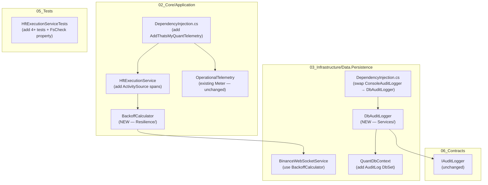

# Design Document: Execution Hardening

## Overview

This document covers four production hardening improvements to the ThatsMyQuant HFT system:

1. **WebSocket Exponential Backoff** — replace the fixed 3-second reconnect delay in `BinanceWebSocketService` with a capped exponential backoff + jitter strategy, extracted into a reusable `BackoffCalculator`.
2. **DbAuditLogger** — replace `ConsoleAuditLogger` with a database-backed `DbAuditLogger` that persists every audit event to SQLite via EF Core, surviving restarts and supporting queries by correlation ID and time range.
3. **OpenTelemetry OTLP Export** — wire the existing `OperationalTelemetry` meters and add distributed tracing spans in `HftExecutionService`, exporting both to an OTLP endpoint (with Prometheus fallback).
4. **HftExecutionService Tests** — expand test coverage from 3 to 7+ tests covering timeout-driven market fallback, queue position adjustment, slippage formula correctness, urgency-based routing, and the urgency range invariant via FsCheck property testing.

All changes are additive or drop-in replacements. No existing public interfaces change.

---

## Architecture

The four changes touch three layers of the solution:



### Key Design Decisions

**BackoffCalculator as a static class in `02_Core`**: The backoff formula is pure math with no dependencies. Placing it in `Application/Resilience/` alongside `ResiliencePolicies.cs` keeps all resilience primitives co-located and makes it testable without any DI setup.

**DbAuditLogger uses `IDbContextFactory<QuantDbContext>`**: `IAuditLogger` is registered as a singleton. `QuantDbContext` is scoped. Using `IDbContextFactory` lets `DbAuditLogger` create a short-lived context per write, avoiding the "singleton consuming scoped service" anti-pattern.

**OpenTelemetry wired in `02_Core` DI, not `Program.cs`**: The requirement explicitly states no changes to `Program.cs`. The new `AddThatsMyQuantTelemetry(IConfiguration)` extension is added to the existing `DependencyInjection.cs` in `02_Core/Application/Common/`, and the existing `AddThatsMyQuantApplication` call in `Program.cs` gains an `IConfiguration` parameter.

**ActivitySource as a static field on HftExecutionService**: `ActivitySource` is thread-safe and designed to be a long-lived static. This avoids DI overhead on the hot execution path.

---

## Components and Interfaces

### 1. BackoffCalculator

**File:** `02_Core/Application/Resilience/BackoffCalculator.cs`

```csharp
namespace ThatsMyQuant.Application.Resilience;

public static class BackoffCalculator
{
    /// <summary>
    /// Computes exponential backoff delay with optional jitter.
    /// Base delay = min(2^attempt, 60) seconds.
    /// Jitter adds a random value in [0, base * jitterFactor].
    /// </summary>
    public static TimeSpan Compute(int attempt, double jitterFactor = 0.3)
    {
        var baseSeconds = Math.Min(Math.Pow(2, attempt), 60.0);
        var jitter = Random.Shared.NextDouble() * baseSeconds * jitterFactor;
        return TimeSpan.FromSeconds(baseSeconds + jitter);
    }
}
```

### 2. BinanceWebSocketService (modified)

**File:** `03_Infrastructure/Data.Persistence/Services/BinanceWebSocketService.cs`

Changes:
- Add `IAlertingService _alertingService` constructor parameter (optional, defaults to null for backward compat).
- Add `int _reconnectAttempt` field, reset to 0 on successful connect.
- Replace `await Task.Delay(3000, stoppingToken)` with `await Task.Delay(BackoffCalculator.Compute(_reconnectAttempt), stoppingToken)`.
- After `MaxReconnectAttempts` consecutive failures, call `_alertingService?.SendTradeAlertAsync(...)`.
- Log each attempt at `Warning` level with attempt number and computed delay.

The reconnect loop (to be added to `ReceiveLoopAsync` or a wrapping `RunWithReconnectAsync` method):

```csharp
private async Task RunWithReconnectAsync(string[] symbols, CancellationToken token)
{
    int attempt = 0;
    while (!token.IsCancellationRequested)
    {
        try
        {
            await ConnectCoreAsync(symbols, token);
            attempt = 0; // reset on success
        }
        catch (Exception ex) when (ex is not OperationCanceledException)
        {
            var delay = BackoffCalculator.Compute(attempt);
            _logger.LogWarning(
                "WS reconnect attempt {Attempt} failed. Retrying in {Delay:F1}s.",
                attempt, delay.TotalSeconds);

            if (attempt >= _maxReconnectAttempts && _alertingService != null)
                await _alertingService.SendTradeAlertAsync(
                    $"BinanceWebSocket unrecoverable after {attempt} attempts.");

            await Task.Delay(delay, token);
            attempt++;
        }
    }
}
```

### 3. AuditEntry Entity

**File:** `03_Infrastructure/Data.Persistence/AuditEntry.cs` (new entity, configured in `QuantDbContext`)

```csharp
namespace ThatsMyQuant.Infrastructure.Persistence;

public class AuditEntry
{
    public Guid Id { get; set; }
    public string EventType { get; set; } = "";       // "OrderExecution" | "SecurityEvent"
    public string CorrelationId { get; set; } = "";   // orderId or principalId
    public DateTime TimestampUtc { get; set; }
    public string Payload { get; set; } = "";         // JSON-serialized event details
}
```

### 4. QuantDbContext (modified)

Add to `QuantDbContext`:

```csharp
public DbSet<AuditEntry> AuditLog => Set<AuditEntry>();
```

EF Core model configuration (in `OnModelCreating`):

```csharp
modelBuilder.Entity<AuditEntry>(entity =>
{
    entity.HasKey(a => a.Id);
    entity.Property(a => a.EventType).IsRequired().HasMaxLength(30);
    entity.Property(a => a.CorrelationId).IsRequired().HasMaxLength(120);
    entity.Property(a => a.Payload).HasColumnType("TEXT");
    entity.HasIndex(a => a.CorrelationId);
    entity.HasIndex(a => a.TimestampUtc);
});
```

### 5. DbAuditLogger

**File:** `03_Infrastructure/Data.Persistence/Services/DbAuditLogger.cs`

```csharp
public class DbAuditLogger : IAuditLogger
{
    private readonly IDbContextFactory<QuantDbContext> _factory;
    private readonly ILogger<DbAuditLogger> _logger;

    public DbAuditLogger(IDbContextFactory<QuantDbContext> factory, ILogger<DbAuditLogger> logger)
    {
        _factory = factory;
        _logger = logger;
    }

    public async Task LogOrderExecutionAsync(string orderId, string strategyId, string justification)
    {
        var payload = JsonSerializer.Serialize(new { orderId, strategyId, justification });
        await PersistAsync("OrderExecution", orderId, payload);
    }

    public async Task LogSecurityEventAsync(string principalId, string role, string actionType, string details)
    {
        var payload = JsonSerializer.Serialize(new { principalId, role, actionType, details });
        await PersistAsync("SecurityEvent", principalId, payload);
    }

    public async Task<IReadOnlyList<AuditEntry>> QueryByCorrelationIdAsync(string correlationId)
    {
        await using var db = await _factory.CreateDbContextAsync();
        return await db.AuditLog
            .Where(e => e.CorrelationId == correlationId)
            .OrderBy(e => e.TimestampUtc)
            .ToListAsync();
    }

    public async Task<IReadOnlyList<AuditEntry>> QueryByTimeRangeAsync(DateTime from, DateTime to)
    {
        await using var db = await _factory.CreateDbContextAsync();
        return await db.AuditLog
            .Where(e => e.TimestampUtc >= from && e.TimestampUtc <= to)
            .OrderBy(e => e.TimestampUtc)
            .ToListAsync();
    }

    private async Task PersistAsync(string eventType, string correlationId, string payload)
    {
        try
        {
            await using var db = await _factory.CreateDbContextAsync();
            db.AuditLog.Add(new AuditEntry
            {
                Id = Guid.NewGuid(),
                EventType = eventType,
                CorrelationId = correlationId,
                TimestampUtc = DateTime.UtcNow,
                Payload = payload
            });
            await db.SaveChangesAsync();
        }
        catch (Exception ex)
        {
            _logger.LogError(ex, "Failed to persist audit entry (EventType={EventType}, CorrelationId={CorrelationId})",
                eventType, correlationId);
            throw;
        }
    }
}
```

### 6. OpenTelemetry Wiring

**Extension method added to** `02_Core/Application/Common/DependencyInjection.cs`:

```csharp
public static IServiceCollection AddThatsMyQuantTelemetry(
    this IServiceCollection services, IConfiguration config)
{
    var otlpEndpoint = config["OpenTelemetry:OtlpEndpoint"];
    var otlpProtocol = config["OpenTelemetry:OtlpProtocol"] ?? "Grpc";

    var otelBuilder = services.AddOpenTelemetry()
        .WithMetrics(metrics =>
        {
            metrics.AddMeter("ThatsMyQuant.*");
            if (!string.IsNullOrWhiteSpace(otlpEndpoint))
                metrics.AddOtlpExporter(o =>
                {
                    o.Endpoint = new Uri(otlpEndpoint);
                    o.Protocol = otlpProtocol == "HttpProtobuf"
                        ? OtlpExportProtocol.HttpProtobuf
                        : OtlpExportProtocol.Grpc;
                });
            else
                metrics.AddPrometheusExporter(); // port 9464
        })
        .WithTracing(tracing =>
        {
            tracing.AddSource("ThatsMyQuant.Execution");
            if (!string.IsNullOrWhiteSpace(otlpEndpoint))
                tracing.AddOtlpExporter(o =>
                {
                    o.Endpoint = new Uri(otlpEndpoint);
                    o.Protocol = otlpProtocol == "HttpProtobuf"
                        ? OtlpExportProtocol.HttpProtobuf
                        : OtlpExportProtocol.Grpc;
                });
        });

    return services;
}
```

**HftExecutionService ActivitySource** (static field + span wrapping):

```csharp
private static readonly ActivitySource _activitySource =
    new ActivitySource("ThatsMyQuant.Execution");

// In ExecuteAsync:
using var activity = _activitySource.StartActivity("hft.execute");
activity?.SetTag("signal.symbol", signal.Symbol);
try { ... }
catch (Exception ex) { activity?.SetStatus(ActivityStatusCode.Error); activity?.RecordException(ex); throw; }

// In ExecuteLimitOrderAsync:
using var activity = _activitySource.StartActivity("hft.execute.limit");
activity?.SetTag("signal.symbol", signal.Symbol);
```

### 7. DI Registration Changes

**`03_Infrastructure/Data.Persistence/DependencyInjection.cs`** — swap audit logger:

```csharp
// Before:
services.AddSingleton<IAuditLogger, ConsoleAuditLogger>();

// After:
services.AddSingleton<IAuditLogger, DbAuditLogger>();
```

Also requires `AddDbContextFactory<QuantDbContext>` to be registered (add if not already present).

**`02_Core/Application/Common/DependencyInjection.cs`** — add telemetry call:

```csharp
public static IServiceCollection AddThatsMyQuantApplication(
    this IServiceCollection services, IConfiguration? config = null)
{
    // ... existing registrations ...
    if (config != null)
        services.AddThatsMyQuantTelemetry(config);
    return services;
}
```

---

## Data Models

### AuditEntry

| Column | Type | Constraints |
|---|---|---|
| `Id` | `GUID` | PK |
| `EventType` | `VARCHAR(30)` | NOT NULL — `"OrderExecution"` or `"SecurityEvent"` |
| `CorrelationId` | `VARCHAR(120)` | NOT NULL, **indexed** |
| `TimestampUtc` | `DATETIME` | NOT NULL, **indexed** |
| `Payload` | `TEXT` | JSON blob of event-specific fields |

**OrderExecution payload shape:**
```json
{ "orderId": "...", "strategyId": "...", "justification": "..." }
```

**SecurityEvent payload shape:**
```json
{ "principalId": "...", "role": "...", "actionType": "...", "details": "..." }
```

### BackoffCalculator — delay table

| Attempt | Base delay | Max delay (with 30% jitter) |
|---|---|---|
| 0 | 1s | 1.3s |
| 1 | 2s | 2.6s |
| 2 | 4s | 5.2s |
| 3 | 8s | 10.4s |
| 4 | 16s | 20.8s |
| 5 | 32s | 41.6s |
| 6+ | 60s (capped) | 78s |

---

## Correctness Properties

*A property is a characteristic or behavior that should hold true across all valid executions of a system — essentially, a formal statement about what the system should do. Properties serve as the bridge between human-readable specifications and machine-verifiable correctness guarantees.*

### Property 1: Backoff delay bounds

*For any* reconnect attempt number `n` in `[0, 10]`, the delay returned by `BackoffCalculator.Compute(n)` SHALL satisfy `delay >= 1 second` and `delay <= 78 seconds` (60s cap + 30% max jitter).

**Validates: Requirements 1.1, 1.2, 1.6, 1.10**

### Property 2: Reconnect counter resets on success

*For any* number of consecutive failed reconnect attempts `n >= 0`, after a successful connection the internal failure counter SHALL be 0.

**Validates: Requirements 1.8**

### Property 3: Order execution audit round-trip

*For any* `orderId`, `strategyId`, and `justification` string, calling `LogOrderExecutionAsync` SHALL result in an `AuditEntry` row in the database with `EventType = "OrderExecution"`, `CorrelationId = orderId`, and a `Payload` containing all three input values.

**Validates: Requirements 2.1, 2.3**

### Property 4: Security event audit round-trip

*For any* `principalId`, `role`, `actionType`, and `details` string, calling `LogSecurityEventAsync` SHALL result in an `AuditEntry` row in the database with `EventType = "SecurityEvent"`, `CorrelationId = principalId`, and a `Payload` containing all four input values.

**Validates: Requirements 2.2, 2.4**

### Property 5: CorrelationId query returns only matching entries in order

*For any* set of audit entries with varying `CorrelationId` values, querying by a specific `CorrelationId` SHALL return only entries matching that ID, ordered by `TimestampUtc` ascending.

**Validates: Requirements 2.9**

### Property 6: Time range query returns only in-range entries in order

*For any* set of audit entries with varying `TimestampUtc` values and any `[from, to]` range, querying by that range SHALL return only entries where `TimestampUtc >= from` and `TimestampUtc <= to`, ordered by `TimestampUtc` ascending.

**Validates: Requirements 2.10**

### Property 7: ExecuteAsync span carries signal symbol

*For any* signal with a non-empty `Symbol`, calling `HftExecutionService.ExecuteAsync` SHALL create an `Activity` with name `"hft.execute"` and tag `signal.symbol` equal to the signal's symbol.

**Validates: Requirements 3.4**

### Property 8: ExecuteLimitOrderAsync span carries signal symbol

*For any* signal with a non-empty `Symbol`, calling `HftExecutionService.ExecuteLimitOrderAsync` SHALL create an `Activity` with name `"hft.execute.limit"` and tag `signal.symbol` equal to the signal's symbol.

**Validates: Requirements 3.5**

### Property 9: Slippage formula correctness

*For any* fill price `f > 0` and signal price `s > 0`, the `EntrySlippagePercent` recorded by `ExecuteAsync` SHALL equal `|f - s| / s * 100`.

**Validates: Requirements 4.3**

### Property 10: Urgency range invariant

*For any* signal confidence value in `[0, 100]`, order flow imbalance in `[0.0, 1.0]`, and wall age in `[0, 10000]`, the urgency computed internally by `HftExecutionService` SHALL be in `[0.0, 1.0]`.

**Validates: Requirements 4.6**

### Property 11: Max retries removes order from active set

*For any* `LimitOrderExecutionConfig` with `MaxRetries >= 1`, after calling `ManageLimitOrderAsync` exactly `MaxRetries` times for the same order, `GetActiveOrders()` SHALL not contain that order.

**Validates: Requirements 4.7**

### Property Reflection

After reviewing all 11 properties:

- Properties 3 and 4 are distinct (different event types, different field sets) — keep both.
- Properties 7 and 8 are distinct (different method names, different span names) — keep both.
- Property 1 subsumes the specific examples in 1.3, 1.4, 1.5, 1.6 — those become unit test examples, not additional properties.
- No further consolidation needed; each property validates a unique behavioral invariant.

---

## Error Handling

| Scenario | Component | Behavior |
|---|---|---|
| DB write fails in `DbAuditLogger` | `DbAuditLogger.PersistAsync` | Log at `Error` level, rethrow — caller is notified |
| WebSocket reconnect exhausts `MaxReconnectAttempts` | `BinanceWebSocketService` | Call `IAlertingService.SendTradeAlertAsync`, continue loop (do not crash the service) |
| `IExchangeService.ExecuteOrderAsync` throws during HFT execution | `HftExecutionService` | Set span status to `Error`, record exception on span, rethrow |
| OTLP endpoint unreachable | OpenTelemetry SDK | SDK handles internally with retry/drop; no exception propagates to application code |
| `OpenTelemetry:OtlpEndpoint` missing from config | `AddThatsMyQuantTelemetry` | Fall back to Prometheus exporter on port 9464 |
| `IDbContextFactory` unavailable at startup | DI container | Startup fails fast with a clear `InvalidOperationException` — misconfiguration is caught at boot |

---

## Testing Strategy

### Unit Tests (example-based)

These cover specific examples, edge cases, and error conditions:

- `BackoffCalculator_Attempt0_Returns1Second` — verifies 1.3
- `BackoffCalculator_Attempt1_Returns2Seconds` — verifies 1.4
- `BackoffCalculator_Attempt4_Returns16Seconds` — verifies 1.5
- `BackoffCalculator_HighAttempt_CapsAt60Seconds` — verifies 1.6 (jitterFactor=0)
- `WebSocketReconnector_ExhaustsAttempts_SendsAlert` — verifies 1.7
- `WebSocketReconnector_LogsWarning_OnEachAttempt` — verifies 1.9
- `DbAuditLogger_WriteFailure_LogsErrorAndRethrows` — verifies 2.7
- `DbAuditLogger_IsRegisteredAsSingleton` — verifies 2.8
- `Telemetry_FallsBackToPrometheus_WhenOtlpEndpointMissing` — verifies 3.3
- `Telemetry_SetsGrpcProtocol_ByDefault` — verifies 3.9
- `Telemetry_SetsSpanStatusError_WhenExchangeThrows` — verifies 3.6
- `HftExecution_FallsBackToMarket_WhenOrderAgeExceedsMax` — verifies 4.1
- `HftExecution_AdjustsLimitPrice_WhenQueuePositionBelowMin` — verifies 4.2
- `HftExecution_SetsLimitMakerMode_WhenUrgencyBelowThreshold` — verifies 4.4
- `HftExecution_FallsBackToMarket_WhenUrgencyHigh` — verifies 4.5 (existing test)

### Property-Based Tests (FsCheck)

The project already has `FsCheck.Xunit` in the test project. Each property test runs a minimum of 100 iterations.

Tag format: `// Feature: execution-hardening, Property {N}: {property_text}`

| Property | FsCheck Generator | Assertion |
|---|---|---|
| P1: Backoff bounds | `Gen.Choose(0, 10)` for attempt | `1s <= result <= 78s` |
| P2: Counter reset | `Gen.Choose(0, 20)` for failure count | counter == 0 after success |
| P3: Order execution round-trip | `Arb.Generate<string>` for orderId/strategyId/justification | Row exists with correct fields |
| P4: Security event round-trip | `Arb.Generate<string>` for principalId/role/actionType/details | Row exists with correct fields |
| P5: CorrelationId query | Random list of `AuditEntry` with random CorrelationIds | Only matching entries, ascending order |
| P6: Time range query | Random list of `AuditEntry` with random timestamps | Only in-range entries, ascending order |
| P7: ExecuteAsync span | Random `Signal` with non-empty Symbol | Activity name and tag correct |
| P8: ExecuteLimitOrderAsync span | Random `Signal` with non-empty Symbol | Activity name and tag correct |
| P9: Slippage formula | `Gen.Positive<decimal>` for fill and signal price | `|f-s|/s*100` matches recorded value |
| P10: Urgency range | `Gen.Choose(0,100)`, `Gen.Double` in [0,1], `Gen.Choose(0,10000)` | urgency in [0.0, 1.0] |
| P11: Max retries removes order | `Gen.Choose(1, 10)` for MaxRetries | `GetActiveOrders()` empty after MaxRetries calls |

Properties P3–P6 use an in-memory SQLite database (already available via `Microsoft.EntityFrameworkCore.Sqlite` in the test project).

Properties P7–P8 use `ActivityListener` from `System.Diagnostics` to capture spans without a real OTLP endpoint.

### Integration Tests

- Verify `AuditLog` table is created by EF migrations and survives a restart (SQLite file persists).
- Verify OTLP exporter is configured when `OpenTelemetry:OtlpEndpoint` is set in config.

### NuGet Packages Required

Add to `ThatsMyQuant.Infrastructure.csproj` (or the Application project):

```xml
<PackageReference Include="OpenTelemetry.Extensions.Hosting" Version="1.*" />
<PackageReference Include="OpenTelemetry.Exporter.OpenTelemetryProtocol" Version="1.*" />
<PackageReference Include="OpenTelemetry.Exporter.Prometheus.AspNetCore" Version="1.*" />
```
