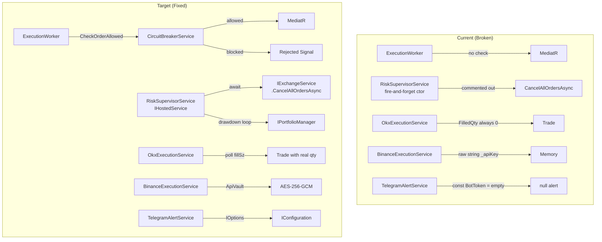

# Design Document — Live Trading Safety

## Overview

This document covers the Phase 1 safety-critical fixes required before ThatsMyQuant can be trusted with real funds. Eight gaps exist where safety infrastructure is present in code but commented out, stubbed, fire-and-forgotten, or bypassed. The changes are surgical — no new architectural layers, no new services — just wiring what already exists and filling the three stubs that were left as `// TODO`.

The eight requirements map to five components that need changes:

| Component | File | Change Type |
|---|---|---|
| `RiskSupervisorService` | `02_Core/Application/Risk/RiskSupervisorService.cs` | Rewrite (IHostedService, drawdown, halt wiring) |
| `ExecutionWorker` | `01_Services/Execution.Worker/ExecutionWorker.cs` | Wire `CircuitBreakerService` into hot path |
| `OkxExecutionService` | `03_Infrastructure/Data.Persistence/Services/OkxExecutionService.cs` | Add fill-status polling |
| `BinanceExecutionService` | `03_Infrastructure/Data.Persistence/Services/BinanceExecutionService.cs` | Replace raw strings with `ApiVault` |
| `TelegramAlertService` | `03_Infrastructure/Data.Persistence/Services/TelegramAlertService.cs` | Replace hardcoded constants with `IOptions<TelegramOptions>` |

---

## Architecture

### Component Diagram (Current vs Target)



### Key Design Decisions

1. `RiskSupervisorService` extends `BackgroundService` (not raw `IHostedService`) — `BackgroundService` provides the `ExecuteAsync` pattern with built-in cancellation, eliminating the fire-and-forget constructor bug.

2. `CircuitBreakerService` is already fully implemented and registered in DI. The only missing piece is wiring it into `ExecutionWorker.ProcessSingleSignal`. No changes to `CircuitBreakerService` itself.

3. `IExchangeService.CancelAllOrdersAsync` already exists in the interface and is already implemented in both `BinanceExecutionService` and `OkxExecutionService`. The only missing piece is the `await` call in `RiskSupervisorService.TriggerEmergencyHaltAsync`.

4. OKX fill tracking requires a new private method `PollFillStatusAsync(string ordId, string instId, decimal requestedQty, CancellationToken ct)` — the existing `ExecuteOrderAsync` extracts the `ordId` from the response and calls it.

5. `BinanceExecutionService` currently stores `_apiKey` as a raw `string` and `_apiSecretBytes` as a raw `byte[]`. The refactor replaces these with two `ApiVault` instances (`_keyVault`, `_secretVault`) and updates `ComputeSignature` to use the transient-decrypt pattern already used by `OkxExecutionService`.

6. `TelegramOptions` is a new POCO in `06_Contracts/Options/` (alongside the existing `RiskGovernorOptions`).

---

## Components and Interfaces

### 1. RiskSupervisorService (Req 1, 2, 3)

**Current problems:**
- Constructor does `_ = StartMonitoringLoop()` (fire-and-forget)
- `TriggerEmergencyHaltAsync` has `// await _execution.CancelAllOrdersAsync();` commented out
- `StartMonitoringLoop` has `// If drawdown > X%, trigger halt` stub with no implementation
- Accepts `MemoryPortfolioManager` (concrete) instead of `IPortfolioManager`

**Target class signature:**
```csharp
public sealed class RiskSupervisorService : BackgroundService
{
    private readonly ILogger<RiskSupervisorService> _logger;
    private readonly IExchangeService _execution;
    private readonly IPortfolioManager _portfolio;

    private readonly decimal _maxDrawdownPercent;
    private volatile bool _isHalted;
    private decimal _initialBalance;
    private decimal _peakBalance;
    private decimal _currentDrawdownPercent;

    public decimal CurrentDrawdownPercent => _currentDrawdownPercent;

    public RiskSupervisorService(
        ILogger<RiskSupervisorService> logger,
        IExchangeService execution,
        IPortfolioManager portfolio,
        decimal maxDrawdownPercent = 5.0m);

    protected override async Task ExecuteAsync(CancellationToken stoppingToken);

    public async Task TriggerEmergencyHaltAsync(string reason);
}
```

**`ExecuteAsync` logic:**
```
1. Record _initialBalance = _portfolio.GetAvailableBalance("USDT")
2. _peakBalance = _initialBalance
3. Loop while !stoppingToken.IsCancellationRequested:
   a. await Task.Delay(1000, stoppingToken)
   b. try:
      - currentBalance = _portfolio.GetAvailableBalance("USDT")
      - _peakBalance = Max(_peakBalance, currentBalance)
      - if _peakBalance <= 0: log warning, continue
      - _currentDrawdownPercent = (_peakBalance - currentBalance) / _peakBalance * 100
      - if _currentDrawdownPercent >= _maxDrawdownPercent:
          await TriggerEmergencyHaltAsync($"Drawdown {_currentDrawdownPercent:F2}% >= {_maxDrawdownPercent}% threshold")
   c. catch (OperationCanceledException): break
   d. catch (Exception ex): log Critical, continue
```

**`TriggerEmergencyHaltAsync` logic:**
```
1. if _isHalted: return (idempotent)
2. _isHalted = true
3. log Critical with reason
4. try:
   await _execution.CancelAllOrdersAsync()
5. catch (Exception ex):
   log Critical(ex, "Failed to cancel orders during emergency halt")
   // _isHalted remains true
6. log Critical "SYSTEM HALTED. MANUAL INTERVENTION REQUIRED."
```

**DI registration** (in `02_Core/Application/Common/DependencyInjection.cs`):
```csharp
services.AddHostedService<RiskSupervisorService>();
```

### 2. ExecutionWorker (Req 4)

**Current problems:**
- `ProcessSingleSignal` dispatches directly to MediatR with no circuit breaker check
- `CircuitBreakerService` is registered in DI but never injected into `ExecutionWorker`

**Constructor change:**
```csharp
public ExecutionWorker(
    ILogger<ExecutionWorker> logger,
    IServiceProvider serviceProvider,
    TickPipeline tickPipeline,
    CircuitBreakerService circuitBreaker)  // ADD THIS
```

**`ProcessSingleSignal` change:**
```csharp
private async Task ProcessSingleSignal(Signal signal, ISignalRepository repo, IMediator mediator, CancellationToken ct)
{
    // NEW: circuit breaker check before dispatch
    var (allowed, blockReason) = _circuitBreaker.CheckOrderAllowed();
    if (!allowed)
    {
        signal.Status = TradeStatus.Rejected;
        signal.Reasoning += $" | CircuitBreaker: {blockReason}";
        _logger.LogWarning("Signal {Id} blocked by circuit breaker: {Reason}", signal.Id, blockReason);
        await repo.UpdateAsync(signal);
        return;
    }

    try
    {
        var tradeResult = await mediator.Send(new ExecuteTradeCommand(signal), ct);
        ApplyExecutionResult(signal, tradeResult);
        _circuitBreaker.RecordSuccess();  // NEW
    }
    catch (Exception ex)
    {
        HandleExecutionException(signal, ex);
        _circuitBreaker.RecordError(ex);  // NEW
    }
    finally
    {
        await repo.UpdateAsync(signal);
    }
}
```

**Halt check** — add at the top of `PollAndProcessSignalsAndTrades`:
```csharp
// NEW: skip polling entirely when halted
if (_circuitBreaker.IsHalted)
{
    _logger.LogWarning("ExecutionWorker: system halted, skipping signal dispatch.");
    return;
}
```

### 3. OkxExecutionService — Fill Tracking (Req 5)

**Current problem:** `ExecuteOrderAsync` returns a `Trade` with `FilledQuantity = 0m` and `RemainingQuantity = signal.Quantity` regardless of actual fill.

**New private method:**
```csharp
private async Task<(decimal FilledQty, decimal RemainingQty, TradeStatus Status)> PollFillStatusAsync(
    string ordId,
    string instId,
    decimal requestedQty,
    CancellationToken cancellationToken = default)
```

**Poll logic:**
```
maxAttempts = 3, delayMs = 500
for attempt in 1..maxAttempts:
    try:
        GET /api/v5/trade/order?instId={instId}&ordId={ordId}
        parse fillSz from response data[0].fillSz
        parse state from response data[0].state
        switch state:
            "filled":         return (fillSz, 0, TradeStatus.Executed)
            "partially_filled": return (fillSz, requestedQty - fillSz, TradeStatus.Pending)
            "live":           return (0, requestedQty, TradeStatus.Pending)
            default:          return (0, requestedQty, TradeStatus.Pending)
    catch (Exception ex):
        log error
        if last attempt: return (0, requestedQty, TradeStatus.Pending)
        await Task.Delay(delayMs, cancellationToken)
```

**`ExecuteOrderAsync` change** — after parsing `ordId` from the placement response:
```csharp
var ordId = doc.RootElement.GetProperty("data")[0].GetProperty("ordId").GetString() ?? "";
var (filledQty, remainingQty, fillStatus) = await PollFillStatusAsync(ordId, okxSymbol, signal.Quantity);

return new Trade
{
    // ... existing fields ...
    FilledQuantity = filledQty,
    RemainingQuantity = remainingQty,
    Quantity = filledQty,
    Status = fillStatus,
    // ...
};
```

### 4. BinanceExecutionService — ApiVault (Req 8)

**Current problem:** `_apiKey` is a raw `string` field; `_apiSecretBytes` is a raw `byte[]` field; `_hmac` is a long-lived `HMACSHA256` instance holding the plaintext key.

**Constructor change:**
```csharp
public BinanceExecutionService(
    ILogger<BinanceExecutionService> logger,
    HttpClient httpClient,
    ApiVault keyVault,       // replaces string apiKey
    ApiVault secretVault,    // replaces string apiSecret
    IStreamingMarketDataService streamingService,
    ISharedPortfolioStateManager? portfolioStateManager = null)
{
    _logger = logger;
    _httpClient = httpClient;
    _keyVault = keyVault;
    _secretVault = secretVault;
    _portfolio = portfolioStateManager ?? VenuePortfolioManager.Instance;

    // Read API key transiently for the HTTP header — zero out immediately
    byte[] keyBytes = _keyVault.GetTransientDecryptedKey();
    try
    {
        _httpClient.DefaultRequestHeaders.Add("X-MBX-APIKEY",
            Encoding.UTF8.GetString(keyBytes));
    }
    finally
    {
        Array.Clear(keyBytes, 0, keyBytes.Length);
    }
    // ...
}
```

**`ComputeSignature` change:**
```csharp
private string ComputeSignature(string message)
{
    int byteCount = Encoding.UTF8.GetByteCount(message);
    Span<byte> messageBytes = byteCount <= 1024 ? stackalloc byte[byteCount] : new byte[byteCount];
    Encoding.UTF8.GetBytes(message, messageBytes);

    byte[] secretBytes = _secretVault.GetTransientDecryptedKey();
    try
    {
        Span<byte> hashBytes = stackalloc byte[32];
        HMACSHA256.HashData(secretBytes, messageBytes, hashBytes);
        return Convert.ToHexString(hashBytes).ToLowerInvariant();
    }
    finally
    {
        Array.Clear(secretBytes, 0, secretBytes.Length);
    }
}
```

**`Dispose` change:**
```csharp
public void Dispose()
{
    _keyVault?.Dispose();
    _secretVault?.Dispose();
    // Remove _hmac field entirely — no longer needed
}
```

**`Program.cs` registration change** (in `01_Services/Execution.Worker/Program.cs`):
```csharp
builder.Services.AddSingleton<BinanceExecutionService>(sp =>
{
    var rawKey    = builder.Configuration["Binance:ApiKey"]    ?? "";
    var rawSecret = builder.Configuration["Binance:ApiSecret"] ?? "";
    var keyVault    = new ApiVault(); keyVault.SecureInboundKey(rawKey);
    var secretVault = new ApiVault(); secretVault.SecureInboundKey(rawSecret);
    // rawKey and rawSecret go out of scope here
    return new BinanceExecutionService(
        sp.GetRequiredService<ILogger<BinanceExecutionService>>(),
        sp.GetRequiredService<IHttpClientFactory>().CreateClient("Binance"),
        keyVault,
        secretVault,
        sp.GetRequiredService<IStreamingMarketDataService>(),
        sp.GetService<ISharedPortfolioStateManager>());
});
```

### 5. TelegramAlertService — IOptions (Req 7)

**New `TelegramOptions` class** (in `06_Contracts/Options/TelegramOptions.cs`):
```csharp
namespace ThatsMyQuant.Contracts.Options;

public sealed class TelegramOptions
{
    public string BotToken { get; set; } = string.Empty;
    public string ChatId   { get; set; } = string.Empty;
}
```

**`TelegramAlertService` constructor change:**
```csharp
public TelegramAlertService(
    ILogger<TelegramAlertService> logger,
    HttpClient httpClient,
    IOptions<TelegramOptions> options)
{
    _logger = logger;
    _httpClient = httpClient;
    _options = options;
}
```

**`SendTradeAlertAsync` change** — replace `if (string.IsNullOrEmpty(BotToken))` with:
```csharp
var opts = _options.Value;
if (string.IsNullOrEmpty(opts.BotToken))
{
    _logger.LogInformation("MOCK ALERT ...");
    return;
}
// use opts.BotToken and opts.ChatId instead of constants
```

**DI registration** (in `03_Infrastructure/Data.Persistence/DependencyInjection.cs`):
```csharp
services.Configure<TelegramOptions>(configuration.GetSection("Telegram"));
```

---

## Data Models

### TelegramOptions (new)

```csharp
// File: 06_Contracts/Options/TelegramOptions.cs
namespace ThatsMyQuant.Contracts.Options;

public sealed class TelegramOptions
{
    public string BotToken { get; set; } = string.Empty;
    public string ChatId   { get; set; } = string.Empty;
}
```

Bound from `IConfiguration` section `"Telegram"`. Values come from:
- Local dev: `dotnet user-secrets set "Telegram:BotToken" "..."` 
- Production: environment variables `Telegram__BotToken`, `Telegram__ChatId`
- Never in `appsettings.json` or `appsettings.Development.json`

### Trade model — no changes needed

`Trade` already has `FilledQuantity`, `RemainingQuantity`, and `RequestedQuantity` fields. The OKX fix populates them correctly — no schema change required.

### RiskSupervisorService state fields (new)

| Field | Type | Purpose |
|---|---|---|
| `_initialBalance` | `decimal` | USDT balance at startup |
| `_peakBalance` | `decimal` | Running maximum of observed balances |
| `_currentDrawdownPercent` | `decimal` | Most recently computed drawdown (exposed as property) |
| `_isHalted` | `volatile bool` | Emergency halt flag |
| `_maxDrawdownPercent` | `decimal` | Configurable threshold (default 5.0%) |

---

## Correctness Properties

*A property is a characteristic or behavior that should hold true across all valid executions of a system — essentially, a formal statement about what the system should do. Properties serve as the bridge between human-readable specifications and machine-verifiable correctness guarantees.*

### Property 1: Halt idempotence

*For any* sequence of N calls to `TriggerEmergencyHaltAsync`, the system state after N calls SHALL be identical to the state after 1 call — `_isHalted` remains `true` and `CancelAllOrdersAsync` is called exactly once (on the first invocation), not on subsequent calls.

**Validates: Requirements 1.1**

### Property 2: No-order-after-halt

*For any* signal processed after `TriggerEmergencyHaltAsync` has been called, `IExchangeService.ExecuteOrderAsync` SHALL NOT be called — the exchange call count SHALL remain unchanged from before the signal was processed.

**Validates: Requirements 1.3, 4.1, 4.2**

### Property 3: Drawdown formula invariant

*For any* `peakBalance > 0` and `currentBalance` in `[0, peakBalance]`, the computed `DrawdownPercent = (peakBalance - currentBalance) / peakBalance * 100` SHALL be in `[0, 100]`.

**Validates: Requirements 2.4**

### Property 4: Monotone peak

*For any* sequence of balance observations `b1, b2, ..., bN`, `_peakBalance` after processing the full sequence SHALL equal `Max(b1, b2, ..., bN)` — the peak never decreases.

**Validates: Requirements 2.2**

### Property 5: Loop resilience

*For any* exception thrown by `IPortfolioManager.GetAvailableBalance` during a monitoring iteration, the monitoring loop SHALL continue to the next iteration — the exception SHALL be caught, logged, and not re-thrown.

**Validates: Requirements 3.4**

### Property 6: No-bypass property

*For any* signal where `CircuitBreakerService.CheckOrderAllowed()` returns `(false, _)`, `IExchangeService.ExecuteOrderAsync` SHALL NOT be called — the exchange call count SHALL not increase.

**Validates: Requirements 4.1, 4.2**

### Property 7: Fill quantity invariant

*For any* completed `ExecuteOrderAsync` call where the OKX order was accepted, `Trade.FilledQuantity + Trade.RemainingQuantity` SHALL equal `Trade.RequestedQuantity`.

**Validates: Requirements 5.2, 5.3**

### Property 8: No-throw on poll failure

*For any* HTTP error returned by the OKX fill-status poll endpoint, `ExecuteOrderAsync` SHALL return a valid `Trade` object — it SHALL NOT throw `InvalidOperationException` or `HttpRequestException`.

**Validates: Requirements 5.6**

### Property 9: ApiVault round-trip

*For any* valid API key string `k`, `Encoding.UTF8.GetString(vault.GetTransientDecryptedKey())` after `vault.SecureInboundKey(k)` SHALL equal `k` — the AES-256-GCM encrypt/decrypt cycle SHALL be lossless.

**Validates: Requirements 8.1, 8.3**

### Property 10: Encrypted bytes differ from plaintext

*For any* API key string `k` of length >= 1, the `_encryptedKey` bytes stored in `ApiVault` after `SecureInboundKey(k)` SHALL NOT equal `Encoding.UTF8.GetBytes(k)` — AES-GCM encryption SHALL produce ciphertext distinct from plaintext.

**Validates: Requirements 8.1**

### Property 11: Post-dispose throws

*For any* `ApiVault` instance that has been disposed, calling `GetTransientDecryptedKey()` SHALL throw `InvalidOperationException` — zeroed key material SHALL not be returned as a valid key.

**Validates: Requirements 8.5**

### Property 12: No-throw on missing Telegram config

*For any* `TelegramAlertService` instance constructed with an empty `TelegramOptions` (BotToken = ""), `SendTradeAlertAsync` SHALL complete without throwing — it SHALL log the alert instead of sending HTTP requests.

**Validates: Requirements 7.4**

---

## Error Handling

| Scenario | Component | Behavior |
|---|---|---|
| `CancelAllOrdersAsync` throws during halt | `RiskSupervisorService` | Log Critical, keep `_isHalted = true`, continue |
| `GetAvailableBalance` throws in monitoring loop | `RiskSupervisorService` | Log Critical, continue loop (no re-throw) |
| `_peakBalance` is zero or negative | `RiskSupervisorService` | Log Warning, skip drawdown check for that iteration |
| `CheckOrderAllowed` returns `(false, reason)` | `ExecutionWorker` | Mark signal `Rejected`, log Warning, skip MediatR |
| OKX fill-status poll returns HTTP error | `OkxExecutionService` | Log Error, return `FilledQuantity = 0`, `Status = Pending`, no throw |
| OKX fill-status poll exhausts 3 attempts | `OkxExecutionService` | Return best-known state (`FilledQuantity = 0`, `Status = Pending`) |
| `CancelAllOrdersAsync` called with cancelled token | Both exchange services | Return `0` immediately, no HTTP calls |
| `TelegramOptions.BotToken` is null/empty | `TelegramAlertService` | Fall back to `ILogger.LogInformation`, no HTTP call, no throw |
| `ApiVault.GetTransientDecryptedKey` called after `Dispose` | `ApiVault` | Throw `InvalidOperationException` |
| `ApiVault` is null in `BinanceExecutionService` | `BinanceExecutionService` | Constructor throws `ArgumentNullException` — vaults are required |
| Consecutive execution errors >= threshold | `CircuitBreakerService` | `IsHalted = true`, all subsequent `CheckOrderAllowed` return `(false, ...)` |

---

## Testing Strategy

### Unit Tests

New test file: `05_Tests/ThatsMyQuant.Tests/Risk/RiskSupervisorServiceTests.cs`

| Test | What it verifies |
|---|---|
| `TriggerEmergencyHaltAsync_SetsHaltedAndCallsCancelAllOrders` | Req 1.1 — halt flag set, `CancelAllOrdersAsync` awaited |
| `TriggerEmergencyHaltAsync_WhenCancelThrows_HaltFlagRemainsTrue` | Req 1.2 — exception during cancel does not clear halt |
| `TriggerEmergencyHaltAsync_CalledTwice_CancelAllOrdersCalledOnce` | Property 1 — idempotence |
| `MonitoringLoop_WhenDrawdownExceedsThreshold_TriggersHalt` | Req 2.3 — drawdown threshold enforcement |
| `MonitoringLoop_PeakBalance_NeverDecreases` | Property 4 — monotone peak |
| `MonitoringLoop_WhenGetBalanceThrows_LoopContinues` | Property 5 — loop resilience |
| `MonitoringLoop_WhenPeakIsZero_SkipsDrawdownCheck` | Req 2.5 — zero-peak guard |
| `StartAsync_RecordsInitialBalance` | Req 2.1 — initial balance recorded |
| `StopAsync_CompletesWithinFiveSeconds` | Req 3.5 — clean shutdown |

New test file: `05_Tests/ThatsMyQuant.Tests/Worker/ExecutionWorkerCircuitBreakerTests.cs`

| Test | What it verifies |
|---|---|
| `ProcessSingleSignal_WhenCircuitBreakerBlocks_SignalRejectedNoMediatR` | Property 6 — no-bypass |
| `ProcessSingleSignal_WhenCircuitBreakerAllows_MediatRDispatched` | Req 4.3 — normal path |
| `ProcessSingleSignal_OnSuccess_RecordsSuccess` | Req 4.4 — RecordSuccess called |
| `ProcessSingleSignal_OnException_RecordsError` | Req 4.5 — RecordError called |
| `PollAndProcess_WhenHalted_SkipsDispatch` | Req 1.3 — halt check in polling loop |

New test file: `05_Tests/ThatsMyQuant.Tests/Risk/ApiVaultTests.cs`

| Test | What it verifies |
|---|---|
| `SecureInboundKey_RoundTrip_ReturnsOriginalKey` | Property 9 — vault round-trip |
| `SecureInboundKey_EncryptedBytesDifferFromPlaintext` | Property 10 — ciphertext != plaintext |
| `GetTransientDecryptedKey_AfterDispose_ThrowsInvalidOperationException` | Property 11 — post-dispose throws |

New test file: `05_Tests/ThatsMyQuant.Tests/Infrastructure/TelegramAlertServiceTests.cs`

| Test | What it verifies |
|---|---|
| `SendTradeAlertAsync_WhenBotTokenEmpty_LogsWithoutHttpCall` | Property 12 — no-throw on missing config |
| `SendTradeAlertAsync_WhenBotTokenSet_SendsHttpRequest` | Req 7.3 — normal path uses options |

OKX fill tracking tests (add to existing `OkxExecutionServiceTests.cs`):

| Test | What it verifies |
|---|---|
| `ExecuteOrderAsync_WhenOrderFilled_FilledQtyEqualsRequestedQty` | Property 7 — fill quantity invariant |
| `ExecuteOrderAsync_WhenOrderPartiallyFilled_QuantitiesSumToRequested` | Property 7 — fill quantity invariant |
| `ExecuteOrderAsync_WhenPollFails_ReturnsTradeWithoutThrowing` | Property 8 — no-throw on poll failure |
| `ExecuteOrderAsync_WhenOrderLive_FilledQtyIsZero` | Req 5.4 — live status handling |

### Property-Based Tests

Use **FsCheck** (already available in the test project via NuGet) for the universally quantified properties.

**Property test configuration:** minimum 100 iterations per property.

**Tag format:** `// Feature: live-trading-safety, Property {N}: {property_text}`

```csharp
// Feature: live-trading-safety, Property 3: Drawdown formula invariant
[Property]
public Property DrawdownFormula_AlwaysInZeroToHundred(
    PositiveDecimal peak, NonNegativeDecimal current)
{
    // Arrange: ensure current <= peak
    var peakVal = peak.Get;
    var currentVal = Math.Min(current.Get, peakVal);

    // Act
    var drawdown = (peakVal - currentVal) / peakVal * 100m;

    // Assert
    return (drawdown >= 0m && drawdown <= 100m).ToProperty();
}
```

```csharp
// Feature: live-trading-safety, Property 9: ApiVault round-trip
[Property]
public Property ApiVault_RoundTrip_PreservesKey(NonEmptyString key)
{
    using var vault = new ApiVault();
    vault.SecureInboundKey(key.Get);
    var decrypted = Encoding.UTF8.GetString(vault.GetTransientDecryptedKey());
    return (decrypted == key.Get).ToProperty();
}
```

```csharp
// Feature: live-trading-safety, Property 7: Fill quantity invariant
[Property]
public Property OkxFill_FilledPlusRemaining_EqualsRequested(
    PositiveDecimal requested, NonNegativeDecimal filled)
{
    var requestedQty = requested.Get;
    var filledQty = Math.Min(filled.Get, requestedQty);
    var remainingQty = requestedQty - filledQty;
    return (filledQty + remainingQty == requestedQty).ToProperty();
}
```

### Integration Tests

The existing `SignalPipelineIntegrationTests` cover end-to-end signal flow. After wiring `CircuitBreakerService` into `ExecutionWorker`, add one integration scenario:

- Start the in-memory host, manually call `circuitBreaker.Halt("test")`, send a signal, assert it is persisted with `Status = TradeStatus.Rejected`.

### Structural Tests

Add to `05_Tests/ThatsMyQuant.Tests/Structural/Sprint4BugConditionTests.cs`:

- **B12**: Read `RiskSupervisorService.cs`, assert it does NOT contain `_ = StartMonitoringLoop()` (fire-and-forget gone).
- **B13**: Read `RiskSupervisorService.cs`, assert it does NOT contain `// await _execution.CancelAllOrdersAsync()` (commented-out call gone).
- **B14**: Read `TelegramAlertService.cs`, assert it does NOT contain `private const string BotToken` (hardcoded constant gone).
- **B15**: Read `BinanceExecutionService.cs`, assert it does NOT contain `private readonly string _apiKey` (raw string field gone).
