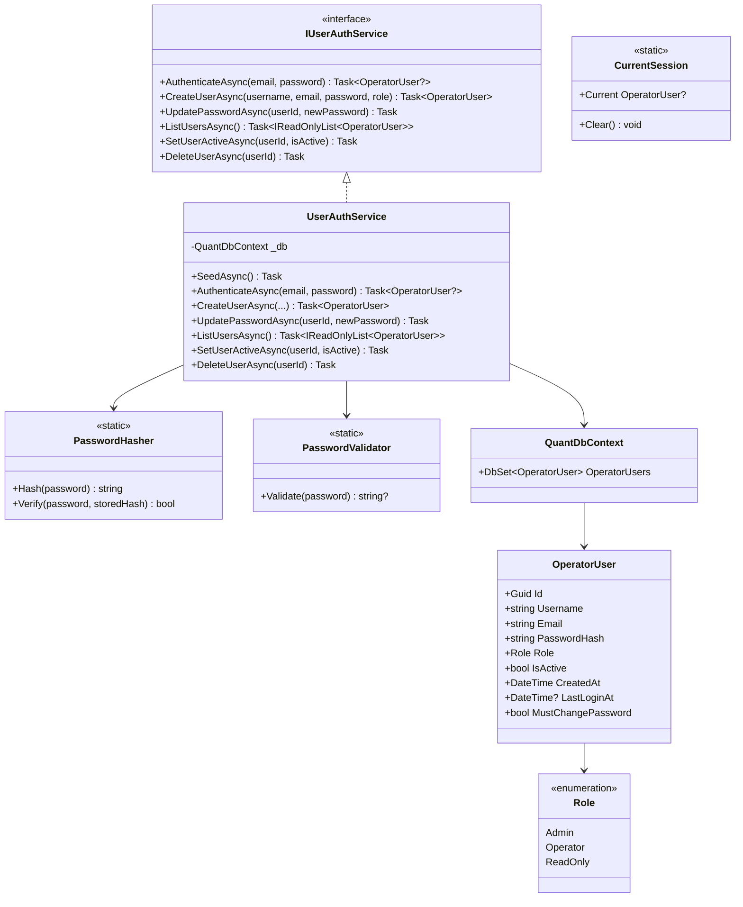
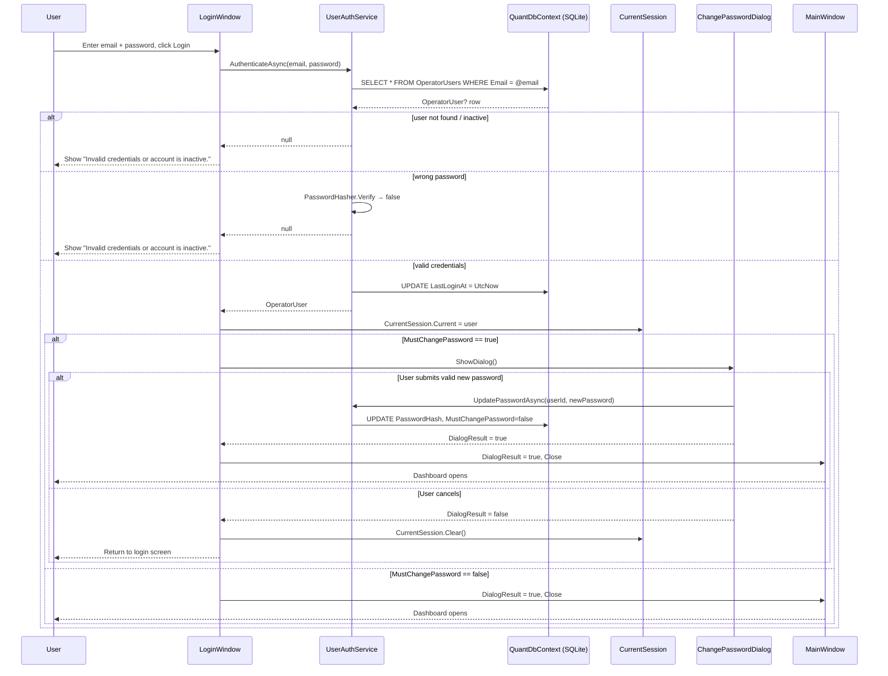

# Design Document: multi-user-auth

## Overview

This feature replaces the hardcoded credential check in `ThatsMyQuant.Dashboard` with a full
multi-user authentication system. It introduces:

- An `OperatorUser` EF Core entity persisted in `quant.db`
- PBKDF2-SHA512 password hashing via a static `PasswordHasher`
- A `PasswordValidator` enforcing complexity rules
- An `IUserAuthService` / `UserAuthService` pair covering all auth and user-management operations
- A `CurrentSession` singleton holding the authenticated user for the application lifetime
- An updated `LoginWindow` that calls the service and handles forced password changes
- A new `ChangePasswordDialog` WPF window
- A new `UserManagementViewModel` and `UserManagementTab` XAML (Admin-only)
- Role-based UI enforcement in `MainViewModel`
- DI registration in `App.xaml.cs`

The feature is entirely self-contained within the existing solution layers:
`06_Contracts` (entity + interface), `03_Infrastructure/Data.Persistence` (EF config),
`04_UI/ThatsMyQuant.Dashboard` (service implementation, UI, session).

---

## Architecture

### Layer Ownership

```
06_Contracts
  └── Models/OperatorUser.cs          ← entity + Role enum
  └── Interfaces/IUserAuthService.cs  ← service contract

03_Infrastructure/Data.Persistence
  └── QuantDbContext.cs               ← DbSet<OperatorUser>, EF config (extended)

04_UI/ThatsMyQuant.Dashboard
  └── Auth/
      ├── PasswordHasher.cs           ← static PBKDF2-SHA512 helper
      ├── PasswordValidator.cs        ← static regex-based validator
      ├── UserAuthService.cs          ← IUserAuthService implementation
      └── CurrentSession.cs          ← thread-safe singleton
  └── ViewModels/SubViewModels/
      └── UserManagementViewModel.cs  ← Admin tab VM
  └── Views/
      ├── ChangePasswordDialog.xaml   ← forced-change dialog
      └── UserManagementTab.xaml      ← Admin-only tab
  └── LoginWindow.xaml.cs             ← updated async handler
  └── App.xaml.cs                     ← DI registration
  └── ViewModels/MainViewModel.cs     ← role-based IsEnabled bindings
```

### Class Diagram



---

## Components and Interfaces

### PasswordHasher (static)

Responsible solely for PBKDF2-SHA512 hashing and verification. No dependencies.

```csharp
// 04_UI/ThatsMyQuant.Dashboard/Auth/PasswordHasher.cs
namespace ThatsMyQuant.Dashboard.Auth;

public static class PasswordHasher
{
    private const int SaltBytes    = 16;
    private const int HashBytes    = 64;
    private const int Iterations   = 100_000;

    // Returns "{iterations}:{base64(salt)}:{base64(hash)}"
    public static string Hash(string password) { ... }

    // Returns true iff password matches storedHash; false on mismatch or malformed hash
    public static bool Verify(string password, string storedHash) { ... }
}
```

**Hash format:** `{iterations}:{base64(16-byte salt)}:{base64(64-byte hash)}`
Example: `100000:abc123==:xyz789...==`

**Verify algorithm:**
1. Split stored hash on `:` — expect exactly 3 parts; return `false` if not.
2. Parse `iterations` as `int`; return `false` on parse failure.
3. Decode salt and expected hash from Base64; return `false` on decode failure.
4. Recompute PBKDF2-SHA512 with the extracted salt and iterations.
5. Compare using `CryptographicOperations.FixedTimeEquals` (constant-time).

### PasswordValidator (static)

Enforces the password complexity policy. Returns `null` on success or a descriptive error string.

```csharp
// 04_UI/ThatsMyQuant.Dashboard/Auth/PasswordValidator.cs
namespace ThatsMyQuant.Dashboard.Auth;

public static class PasswordValidator
{
    // Returns null if valid; otherwise a human-readable error message.
    public static string? Validate(string password) { ... }
}
```

Rules (checked in order, first failure returned):
1. Length ≥ 8 → `"Password must be at least 8 characters."`
2. Contains `[A-Z]` → `"Password must contain at least one uppercase letter."`
3. Contains `[0-9]` → `"Password must contain at least one digit."`
4. Contains one of `! @ # $ % ^ & * ( ) _ + - = [ ] { } ; ' : " , . < > ? /` → `"Password must contain at least one special character."`

### IUserAuthService

```csharp
// 06_Contracts/Interfaces/IUserAuthService.cs
namespace ThatsMyQuant.Contracts.Interfaces;

public interface IUserAuthService
{
    Task<OperatorUser?> AuthenticateAsync(string email, string password);
    Task<OperatorUser>  CreateUserAsync(string username, string email, string password, Role role);
    Task                UpdatePasswordAsync(Guid userId, string newPassword);
    Task<IReadOnlyList<OperatorUser>> ListUsersAsync();
    Task                SetUserActiveAsync(Guid userId, bool isActive);
    Task                DeleteUserAsync(Guid userId);
}
```

### UserAuthService

Lives in `04_UI/ThatsMyQuant.Dashboard/Auth/UserAuthService.cs`. Depends on `QuantDbContext`
(injected), `PasswordHasher`, and `PasswordValidator`.

Key method contracts:

| Method | Behaviour |
|---|---|
| `SeedAsync()` | Called once at startup. If `OperatorUsers` is empty, inserts the default admin. |
| `AuthenticateAsync` | Looks up by email (case-insensitive). Returns `null` if not found, inactive, or wrong password. On success updates `LastLoginAt` and saves. |
| `CreateUserAsync` | Validates password, hashes it, creates entity with `MustChangePassword = false`, `IsActive = true`. |
| `UpdatePasswordAsync` | Validates password, hashes it, sets `MustChangePassword = false`, saves. |
| `SetUserActiveAsync` | Guards against deactivating the last active Admin. |
| `DeleteUserAsync` | Guards against deleting the last active Admin. |

### CurrentSession (static singleton)

```csharp
// 04_UI/ThatsMyQuant.Dashboard/Auth/CurrentSession.cs
namespace ThatsMyQuant.Dashboard.Auth;

public static class CurrentSession
{
    private static volatile OperatorUser? _current;

    public static OperatorUser? Current
    {
        get => _current;
        internal set => _current = value;
    }

    public static void Clear() => _current = null;
}
```

`volatile` ensures visibility across threads without a full lock (reads/writes are atomic for
reference types on .NET).

### LoginWindow changes

`Login_Click` becomes `async void Login_Click`. Flow:

1. Resolve `IUserAuthService` from `App.ServiceProvider`.
2. Call `await AuthenticateAsync(email, password)`.
3. If `null` → show error, return.
4. Set `CurrentSession.Current = user`.
5. If `user.MustChangePassword` → open `ChangePasswordDialog`; if cancelled → `CurrentSession.Clear()`, return.
6. `DialogResult = true; Close()`.

### ChangePasswordDialog

New WPF `Window` with a minimal ViewModel:

```csharp
public partial class ChangePasswordDialogViewModel : ObservableObject
{
    [ObservableProperty] private string _newPassword = "";
    [ObservableProperty] private string _confirmPassword = "";
    [ObservableProperty] private string _errorMessage = "";

    public IRelayCommand SubmitCommand { get; }
    public IRelayCommand CancelCommand { get; }
}
```

Submit validates via `PasswordValidator.Validate`, checks `newPassword == confirmPassword`,
then calls `IUserAuthService.UpdatePasswordAsync`.

### UserManagementViewModel

```csharp
public partial class UserManagementViewModel : ObservableObject
{
    [ObservableProperty] private ObservableCollection<OperatorUser> _users = new();
    [ObservableProperty] private OperatorUser? _selectedUser;

    public IAsyncRelayCommand LoadUsersCommand   { get; }
    public IAsyncRelayCommand AddUserCommand     { get; }
    public IAsyncRelayCommand ResetPasswordCommand { get; }
    public IAsyncRelayCommand ToggleActiveCommand { get; }
    public IAsyncRelayCommand DeleteUserCommand  { get; }
}
```

All commands call the corresponding `IUserAuthService` method and then `LoadUsersCommand` to refresh.

### UserManagementTab XAML (sketch)

```xml
<DataGrid ItemsSource="{Binding Users}" SelectedItem="{Binding SelectedUser}"
          AutoGenerateColumns="False" IsReadOnly="True">
    <DataGrid.Columns>
        <DataGridTextColumn Header="Username"    Binding="{Binding Username}" />
        <DataGridTextColumn Header="Email"       Binding="{Binding Email}" />
        <DataGridTextColumn Header="Role"        Binding="{Binding Role}" />
        <DataGridCheckBoxColumn Header="Active"  Binding="{Binding IsActive}" />
        <DataGridTextColumn Header="Created"     Binding="{Binding CreatedAt, StringFormat=yyyy-MM-dd}" />
        <DataGridTextColumn Header="Last Login"  Binding="{Binding LastLoginAt, StringFormat=yyyy-MM-dd HH:mm}" />
    </DataGrid.Columns>
</DataGrid>
<!-- Toolbar: Add User | Reset Password | Toggle Active | Delete -->
```

The tab is added to `MainWindow.xaml` inside a `TabControl` with a visibility binding:

```xml
<TabItem Header="User Management"
         Visibility="{Binding IsAdminUser, Converter={StaticResource BoolToVisibilityConverter}}">
```

### MainViewModel role enforcement

Two new observable properties added to `MainViewModel`:

```csharp
public bool CanExecuteTrades =>
    CurrentSession.Current?.Role is Role.Operator or Role.Admin;

public bool IsAdminUser =>
    CurrentSession.Current?.Role == Role.Admin;
```

Trade buttons bind `IsEnabled="{Binding CanExecuteTrades}"`.
The User Management tab binds `Visibility` to `IsAdminUser`.

These properties are set once after login (the session does not change mid-run), so no
`PropertyChanged` notification is needed beyond the initial binding resolution.

---

## Data Models

### OperatorUser entity

```csharp
// 06_Contracts/Models/OperatorUser.cs
namespace ThatsMyQuant.Contracts.Models;

public enum Role { Admin, Operator, ReadOnly }

public class OperatorUser
{
    public Guid     Id                { get; set; } = Guid.NewGuid();
    public string   Username          { get; set; } = "";
    public string   Email             { get; set; } = "";
    public string   PasswordHash      { get; set; } = "";
    public Role     Role              { get; set; }
    public bool     IsActive          { get; set; } = true;
    public DateTime CreatedAt         { get; set; } = DateTime.UtcNow;
    public DateTime? LastLoginAt      { get; set; }
    public bool     MustChangePassword { get; set; }
}
```

### EF Core configuration (QuantDbContext extension)

Added inside `OnModelCreating`:

```csharp
modelBuilder.Entity<OperatorUser>(entity =>
{
    entity.ToTable("OperatorUsers");
    entity.HasKey(u => u.Id);

    entity.Property(u => u.Username)
          .IsRequired()
          .HasMaxLength(64);

    entity.Property(u => u.Email)
          .IsRequired()
          .HasMaxLength(256);

    entity.Property(u => u.PasswordHash)
          .IsRequired();

    entity.Property(u => u.Role)
          .HasConversion<string>()   // stored as "Admin" / "Operator" / "ReadOnly"
          .HasMaxLength(16);

    entity.Property(u => u.IsActive).IsRequired();
    entity.Property(u => u.CreatedAt).IsRequired();
    entity.Property(u => u.MustChangePassword).IsRequired();

    entity.HasIndex(u => u.Username).IsUnique();
    entity.HasIndex(u => u.Email).IsUnique();
});
```

### EF Migration Strategy

The project currently uses `EnsureCreatedAsync()` in `App.xaml.cs`. This approach is retained for
the `OperatorUsers` table because:

- `EnsureCreated` creates all tables that do not yet exist without running migrations.
- The existing tables (`Signals`, `Trades`, etc.) are already created this way.
- Adding `OperatorUsers` to `OnModelCreating` means `EnsureCreated` will create it on first run.

**Rationale for not switching to explicit migrations now:**
Introducing `dotnet ef migrations add` would require adding `Microsoft.EntityFrameworkCore.Design`
and a migration history table, which is a larger change than this feature warrants. The
`EnsureCreated` path is sufficient for a desktop SQLite app where the developer controls the
deployment.

**Future path:** If schema evolution is needed (e.g., adding columns to `OperatorUsers`), the team
should switch to explicit migrations at that point.

`SeedAsync()` is called after `EnsureCreatedAsync()` in `App.xaml.cs`:

```csharp
await db.Database.EnsureCreatedAsync();
await authService.SeedAsync();
```

---

## Login Sequence Data Flow



---

## Correctness Properties

*A property is a characteristic or behavior that should hold true across all valid executions of a
system — essentially, a formal statement about what the system should do. Properties serve as the
bridge between human-readable specifications and machine-verifiable correctness guarantees.*

### Property 1: Unique username and email constraints are enforced

*For any* two `OperatorUser` records inserted into the database, if they share the same `Username`
or the same `Email`, the second insert SHALL throw a unique-constraint violation.

**Validates: Requirements 1.3**

---

### Property 2: Password hash format is always well-formed

*For any* non-empty password string, `PasswordHasher.Hash` SHALL return a string that matches the
pattern `^\d+:[A-Za-z0-9+/=]+:[A-Za-z0-9+/=]+$` with exactly two `:` separators, where the first
segment parses as an integer ≥ 100 000, the second segment decodes to exactly 16 bytes, and the
third segment decodes to exactly 64 bytes.

**Validates: Requirements 3.1, 3.2**

---

### Property 3: Password hash round-trip

*For any* password string, `PasswordHasher.Verify(password, PasswordHasher.Hash(password))` SHALL
return `true`.

**Validates: Requirements 3.3**

---

### Property 4: Malformed hash never throws

*For any* string that does not conform to the `{iterations}:{base64}:{base64}` format (including
empty string, single-segment, two-segment, non-numeric iteration count, or invalid Base64),
`PasswordHasher.Verify` SHALL return `false` without throwing any exception.

**Validates: Requirements 3.4** *(edge case)*

---

### Property 5: Authentication succeeds only for active users with correct credentials

*For any* `OperatorUser` in the database:
- If `IsActive = true` and the correct password is supplied, `AuthenticateAsync` SHALL return the
  user and update `LastLoginAt` to a UTC time ≥ the time before the call.
- If `IsActive = false`, `AuthenticateAsync` SHALL return `null` regardless of the password.
- If the password is incorrect, `AuthenticateAsync` SHALL return `null`.
- If the email does not exist, `AuthenticateAsync` SHALL return `null`.

**Validates: Requirements 4.1, 4.2, 4.3, 4.4**

---

### Property 6: UpdatePasswordAsync clears MustChangePassword

*For any* `OperatorUser` with `MustChangePassword = true`, calling
`UpdatePasswordAsync(user.Id, validNewPassword)` SHALL result in `MustChangePassword = false` and
the new password being verifiable via `PasswordHasher.Verify`.

**Validates: Requirements 5.2, 9.3**

---

### Property 7: CurrentSession round-trip

*For any* `OperatorUser`, setting `CurrentSession.Current = user` then calling
`CurrentSession.Clear()` SHALL result in `CurrentSession.Current == null`.

**Validates: Requirements 6.1, 6.3**

---

### Property 8: Seed is idempotent

*For any* database that already contains at least one `OperatorUser`, calling `SeedAsync()` SHALL
NOT increase the count of rows in `OperatorUsers`.

**Validates: Requirements 2.2**

---

### Property 9: Last active Admin cannot be deleted or deactivated

*For any* database state where exactly one `OperatorUser` has `Role = Admin` and `IsActive = true`,
calling `DeleteUserAsync` or `SetUserActiveAsync(id, false)` on that user SHALL throw an
`InvalidOperationException` and leave the database unchanged.

**Validates: Requirements 9.6**

---

### Property 10: SetUserActiveAsync toggles IsActive correctly

*For any* `OperatorUser`, calling `SetUserActiveAsync(user.Id, !user.IsActive)` SHALL result in
`user.IsActive` being the negated value when re-fetched from the database.

**Validates: Requirements 9.4**

---

### Property 11: DeleteUserAsync removes the user

*For any* `OperatorUser` that is not the last active Admin, calling `DeleteUserAsync(user.Id)` SHALL
result in that user no longer appearing in `ListUsersAsync()`.

**Validates: Requirements 9.5**

---

### Property 12: PasswordValidator rejects all non-compliant passwords

*For any* password string that violates at least one of the four complexity rules (length < 8, no
uppercase, no digit, no special character), `PasswordValidator.Validate` SHALL return a non-null,
non-empty string that identifies the violated rule.

*For any* password string that satisfies all four rules, `PasswordValidator.Validate` SHALL return
`null`.

**Validates: Requirements 10.1, 10.2, 10.3, 10.4, 10.5**

---

### Property 13: Service methods throw on invalid password

*For any* password string that `PasswordValidator.Validate` rejects, calling
`CreateUserAsync` or `UpdatePasswordAsync` with that password SHALL throw an `ArgumentException`
containing the validation error message, and no row SHALL be inserted or updated in the database.

**Validates: Requirements 10.6, 10.7**

---

## Error Handling

| Scenario | Handling |
|---|---|
| Malformed `PasswordHash` in DB | `PasswordHasher.Verify` returns `false`; `AuthenticateAsync` returns `null` |
| Invalid password supplied to `CreateUserAsync` / `UpdatePasswordAsync` | `ArgumentException` thrown before any DB write |
| Attempt to delete/deactivate last active Admin | `InvalidOperationException` thrown; no DB change |
| DB connection failure | EF Core exception propagates; `LoginWindow` catches and shows generic error |
| `ChangePasswordDialog` cancelled | `CurrentSession.Clear()` called; user returned to login screen |
| Duplicate username/email on `CreateUserAsync` | EF Core `DbUpdateException` propagates; caller (VM) catches and shows error |

---

## Testing Strategy

### Dual Testing Approach

Both unit tests and property-based tests are required. They are complementary:
- Unit tests cover specific examples, integration points, and edge cases.
- Property-based tests verify universal correctness across randomized inputs.

### Unit Tests (xUnit)

Specific examples and integration points to cover:

- `SeedAsync` on empty DB creates exactly one admin with `Username = "admin"` and `MustChangePassword = true`.
- `AuthenticateAsync` with the seeded admin credentials returns the user.
- `CreateUserAsync` with a valid password creates a user retrievable via `ListUsersAsync`.
- `ChangePasswordDialog` cancel path calls `CurrentSession.Clear()`.
- DI registration: `IUserAuthService` resolves from the service provider.

### Property-Based Tests (FsCheck or CsCheck)

Use **FsCheck** (NuGet: `FsCheck.Xunit`) for .NET property-based testing.
Configure each test with a minimum of **100 iterations**.

Each property test MUST include a comment tag in the format:
`// Feature: multi-user-auth, Property {N}: {property_text}`

Properties to implement as PBT tests:

| Property | Test description |
|---|---|
| P2: Hash format | Generate random non-empty strings; assert format regex matches |
| P3: Hash round-trip | Generate random passwords; assert `Verify(p, Hash(p)) == true` |
| P4: Malformed hash never throws | Generate random malformed strings; assert no exception, returns false |
| P5: Auth failure conditions | Generate random emails/passwords not matching DB; assert null |
| P8: Seed idempotency | Pre-populate DB; call SeedAsync N times; assert count unchanged |
| P12: PasswordValidator rejects non-compliant | Generate strings violating each rule; assert non-null error |
| P12: PasswordValidator accepts compliant | Generate strings satisfying all rules; assert null |
| P13: Service throws on invalid password | Generate invalid passwords; assert ArgumentException |

### Test Project

Tests live in `05_Tests/ThatsMyQuant.Tests`. New test files:

- `Auth/PasswordHasherTests.cs` — Properties 2, 3, 4
- `Auth/PasswordValidatorTests.cs` — Property 12
- `Auth/UserAuthServiceTests.cs` — Properties 5, 6, 8, 9, 10, 11, 13 (uses in-memory SQLite)
- `Auth/CurrentSessionTests.cs` — Property 7
