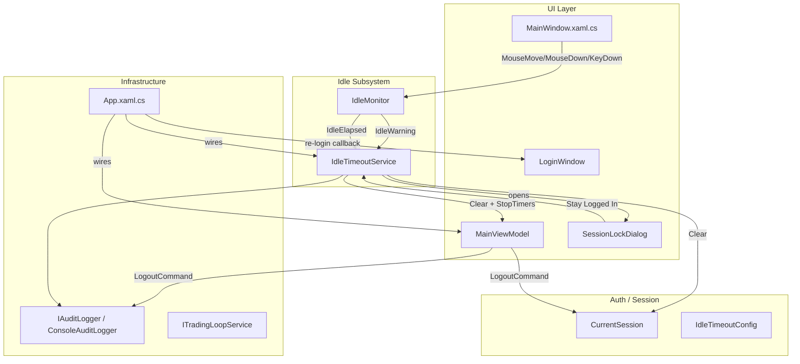

# Design Document: Session Logout

## Overview

The session-logout feature adds two complementary session-termination paths to the
ThatsMyQuant.Dashboard WPF application:

1. **Explicit Logout** — a `LogoutCommand` on `MainViewModel` that operators invoke via a header
   button to voluntarily end their session.
2. **Idle Timeout** — an `IdleMonitor` / `IdleTimeoutService` subsystem that tracks inactivity,
   shows a countdown warning dialog, and automatically locks the session after a configurable
   period.

Both paths converge on the same sequence: write an audit log entry, call
`CurrentSession.Clear()`, stop background timers and trading loops, then re-present
`LoginWindow` via `ShowDialog()`. On successful re-login the `MainWindow` is restored; on
cancellation `Application.Current.Shutdown()` is called.

The design reuses the existing `CurrentSession` static singleton, `IAuditLogger` /
`ConsoleAuditLogger`, `ITradingLoopService`, and the `App.xaml.cs` startup flow.

---

## Architecture



The `IdleTimeoutService` is registered as a singleton in `App.xaml.cs`. It receives an
`IdleTimeoutConfig` (read from `IConfiguration` section `"IdleTimeout"`, falling back to
`IdleTimeoutConfig.Default`), an `IAuditLogger`, and a re-login callback
(`Func<Task<bool>>`) that encapsulates the `LoginWindow.ShowDialog()` flow.

`MainViewModel` gains a `LogoutCommand` (`[RelayCommand]`) and a `StopBackgroundTimers()`
method. The two local `DispatcherTimer` variables in the constructor are promoted to private
fields so `StopBackgroundTimers()` can reach them.

---

## Components and Interfaces

### `IdleTimeoutConfig` (record)

```csharp
// 04_UI/ThatsMyQuant.Dashboard/Auth/IdleTimeoutConfig.cs
public record IdleTimeoutConfig
{
    public int TimeoutSeconds     { get; init; }
    public int WarningLeadSeconds { get; init; }

    public IdleTimeoutConfig(int timeoutSeconds = 300, int warningLeadSeconds = 30)
    {
        if (timeoutSeconds > 0 && warningLeadSeconds >= timeoutSeconds)
            throw new ArgumentException(
                "WarningLeadSeconds must be less than TimeoutSeconds.",
                nameof(warningLeadSeconds));

        TimeoutSeconds     = timeoutSeconds;
        WarningLeadSeconds = warningLeadSeconds;
    }

    public static IdleTimeoutConfig Default  => new(300, 30);
    public static IdleTimeoutConfig Disabled => new(0, 0);   // bypasses validation
}
```

### `IdleMonitor`

```csharp
// 04_UI/ThatsMyQuant.Dashboard/Auth/IdleMonitor.cs
public class IdleMonitor
{
    public event EventHandler? IdleWarning;
    public event EventHandler? IdleElapsed;

    public void Reset();   // zeroes elapsed counter
    public void Start();
    public void Stop();
}
```

Internally owns a `DispatcherTimer` with a 1-second interval. Counts elapsed seconds since
last `Reset()`. Raises `IdleWarning` at `TimeoutSeconds − WarningLeadSeconds` and
`IdleElapsed` at `TimeoutSeconds`. If `TimeoutSeconds == 0` the timer is never started.

### `IdleTimeoutService`

```csharp
// 04_UI/ThatsMyQuant.Dashboard/Services/IdleTimeoutService.cs
public class IdleTimeoutService
{
    public IdleMonitor IdleMonitor { get; }

    public IdleTimeoutService(
        IdleTimeoutConfig config,
        IAuditLogger auditLogger,
        Func<Task<bool>> reLoginCallback);

    public void Attach(MainViewModel viewModel);
    public void Start();
    public void Stop();
}
```

On `IdleWarning`: opens `SessionLockDialog` on the UI thread. On "Stay Logged In":
calls `IdleMonitor.Reset()`. On `IdleElapsed` (or non-"Stay Logged In" dialog close):
calls `viewModel.StopBackgroundTimers()`, `CurrentSession.Clear()`, writes audit log
(`"IdleTimeout"`), then invokes `reLoginCallback`.

### `SessionLockDialog`

```csharp
// 04_UI/ThatsMyQuant.Dashboard/Views/SessionLockDialog.xaml[.cs]
public partial class SessionLockDialog : Window
{
    public int RemainingSeconds { get; set; }
    // "Stay Logged In" button sets DialogResult = true
    // Any other close path sets DialogResult = false
}
```

Owns a `DispatcherTimer` that decrements `RemainingSeconds` and updates the countdown label
every second.

### `MainViewModel` additions

| Addition | Description |
|---|---|
| `_clockTimer` (field) | Promoted from local variable in constructor |
| `_queueTimer` (field) | Promoted from local variable in constructor |
| `_auditLogger` (field) | Injected `IAuditLogger` |
| `StopBackgroundTimers()` | Stops `_clockTimer`, `_queueTimer`, calls `_tradingLoopService.Stop()` |
| `LogoutCommand` | `[RelayCommand]` async method; guard: no-op if `CurrentSession.Current == null` |
| `LogoutRequested` event | Raised after `CurrentSession.Clear()` so `App.xaml.cs` can show `LoginWindow` |

### `App.xaml.cs` additions

- Register `IdleTimeoutService` as singleton; register `IAuditLogger → ConsoleAuditLogger`
  as singleton.
- Extract login flow into `RunLoginFlowAsync()`.
- Subscribe to `MainViewModel.LogoutRequested`; handler hides `MainWindow`, calls
  `RunLoginFlowAsync()`, shows `MainWindow` on success or calls `Shutdown()` on cancel.
- Pass the same `RunLoginFlowAsync` delegate to `IdleTimeoutService`.
- Pass `IConfiguration` (or `appsettings.json`-backed config) to `IdleTimeoutService`.

### `MainWindow.xaml.cs` additions

- Accept `IdleTimeoutService` as a constructor parameter.
- Subscribe `MouseMove`, `MouseDown`, `KeyDown` to `IdleTimeoutService.IdleMonitor.Reset()`.
- Call `IdleTimeoutService.Start()` in the `Loaded` handler.

---

## Data Models

### `IdleTimeoutConfig`

| Property | Type | Default | Constraint |
|---|---|---|---|
| `TimeoutSeconds` | `int` | 300 | ≥ 0; 0 = disabled |
| `WarningLeadSeconds` | `int` | 30 | < `TimeoutSeconds` when `TimeoutSeconds > 0` |

### Audit Log Entry (via `IAuditLogger.LogSecurityEventAsync`)

| Parameter | Value |
|---|---|
| `principalId` | `CurrentSession.Current?.Username ?? "Unknown"` |
| `role` | `CurrentSession.Current?.Role.ToString() ?? "Unknown"` |
| `actionType` | `"ExplicitLogout"` or `"IdleTimeout"` |
| `details` | UTC timestamp string |

### Configuration Section (`appsettings.json`)

```json
{
  "IdleTimeout": {
    "TimeoutSeconds": 300,
    "WarningLeadSeconds": 30
  }
}
```

---

## Correctness Properties

*A property is a characteristic or behavior that should hold true across all valid executions
of a system — essentially, a formal statement about what the system should do. Properties
serve as the bridge between human-readable specifications and machine-verifiable correctness
guarantees.*

### Property 1: Config invariant enforcement

*For any* pair `(timeoutSeconds, warningLeadSeconds)` where `timeoutSeconds > 0` and
`warningLeadSeconds >= timeoutSeconds`, constructing an `IdleTimeoutConfig` SHALL throw an
`ArgumentException`.

**Validates: Requirements 2.3, 7.5**

---

### Property 2: Valid config construction round-trip

*For any* pair `(timeoutSeconds, warningLeadSeconds)` where `0 < warningLeadSeconds < timeoutSeconds`,
constructing an `IdleTimeoutConfig` SHALL succeed and the resulting instance SHALL expose the
same `TimeoutSeconds` and `WarningLeadSeconds` values that were passed in.

**Validates: Requirements 2.1, 2.2, 2.3**

---

### Property 3: Warning always precedes elapsed

*For any* valid `IdleTimeoutConfig` where `TimeoutSeconds > 0` and `WarningLeadSeconds > 0`,
within a single idle cycle the `IdleMonitor` SHALL raise `IdleWarning` before it raises
`IdleElapsed`.

**Validates: Requirements 3.3, 3.4, 7.4**

---

### Property 4: Idle timing accuracy (including after reset)

*For any* valid `IdleTimeoutConfig` where `TimeoutSeconds > 0`, the elapsed time between the
last `Reset()` call (or monitor start) and the `IdleElapsed` event SHALL be within the range
`[TimeoutSeconds, TimeoutSeconds + 2]` seconds. This holds both for the initial idle cycle
and for any cycle that begins after a "Stay Logged In" reset.

**Validates: Requirements 7.3, 7.8**

---

### Property 5: Explicit logout idempotence

*For any* sequence of `LogoutCommand` executions (including repeated calls), `CurrentSession.Current`
SHALL be `null` immediately after each execution completes.

**Validates: Requirements 1.2, 7.1**

---

### Property 6: Idle logout idempotence

*For any* sequence of `IdleElapsed` events (including repeated firings), `CurrentSession.Current`
SHALL be `null` immediately after each idle-logout sequence completes.

**Validates: Requirements 5.1, 7.2**

---

### Property 7: No-op when session is null

*For any* state where `CurrentSession.Current` is `null`, executing `LogoutCommand` SHALL
complete without throwing an unhandled exception and SHALL leave `CurrentSession.Current`
as `null`.

**Validates: Requirements 7.7**

---

### Property 8: Explicit logout audit log correctness

*For any* authenticated `OperatorUser`, when `LogoutCommand` is executed, the `IAuditLogger`
SHALL be called with `actionType = "ExplicitLogout"`, `principalId` equal to the user's
username, and a non-empty `details` string containing a UTC timestamp.

**Validates: Requirements 6.1**

---

### Property 9: Idle logout audit log correctness (including null session)

*For any* idle-logout event, the `IAuditLogger` SHALL be called with `actionType = "IdleTimeout"`.
When `CurrentSession.Current` is non-null at the time of the call, `principalId` SHALL equal
the user's username. When `CurrentSession.Current` is `null`, `principalId` SHALL be
`"Unknown"` and no exception SHALL be thrown.

**Validates: Requirements 5.6, 6.2, 6.3**

---

## Error Handling

| Scenario | Handling |
|---|---|
| `CurrentSession.Current` is null when `LogoutCommand` fires | Guard clause returns immediately; no exception |
| `CurrentSession.Current` is null when audit log is written | Log `"Unknown"` as username; no exception |
| `IdleTimeoutConfig` constructed with `WarningLeadSeconds >= TimeoutSeconds` | `ArgumentException` thrown in constructor |
| `IConfiguration` section `"IdleTimeout"` absent | Fall back to `IdleTimeoutConfig.Default` |
| `TimeoutSeconds = 0` in config | `IdleTimeoutService` skips timer start; idle enforcement disabled |
| `SessionLockDialog` closed via Alt+F4 or X button | `DialogResult = false`; treated as idle-logout trigger |
| `LoginWindow` cancelled after logout-triggered re-login | `Application.Current.Shutdown()` called |
| Exception thrown inside `LogoutCommand` | Caught and logged; `CurrentSession.Clear()` still called to avoid stuck state |

---

## Testing Strategy

### Dual Testing Approach

Both unit tests and property-based tests are required. Unit tests cover specific examples,
integration points, and edge cases. Property tests verify universal invariants across
randomised inputs.

### Unit Tests

Focus areas:
- `IdleTimeoutConfig.Default` has `TimeoutSeconds = 300` and `WarningLeadSeconds = 30`
- `IdleTimeoutConfig.Disabled` has `TimeoutSeconds = 0`
- `IdleMonitor` raises `IdleWarning` before `IdleElapsed` in a single cycle (example with
  small values, e.g. `TimeoutSeconds = 3`, `WarningLeadSeconds = 1`)
- `IdleMonitor` does not start when `TimeoutSeconds = 0`
- `IdleTimeoutService` calls `IdleMonitor.Reset()` when "Stay Logged In" is clicked
- `IdleTimeoutService` proceeds to idle-logout when dialog is closed via non-"Stay Logged In"
  path
- `MainViewModel.LogoutCommand` calls `StopBackgroundTimers()` before `CurrentSession.Clear()`
- `App.xaml.cs` reads `IdleTimeout` section from `IConfiguration` and falls back to defaults
  when absent

### Property-Based Tests (FsCheck.Xunit 3.*)

Each property test runs a minimum of **100 iterations**. Each test is tagged with a comment
referencing the design property it validates.

| Test | Property | Tag |
|---|---|---|
| Invalid config always throws | Property 1 | `Feature: session-logout, Property 1` |
| Valid config round-trips | Property 2 | `Feature: session-logout, Property 2` |
| Warning precedes elapsed | Property 3 | `Feature: session-logout, Property 3` |
| Timing accuracy (initial + post-reset) | Property 4 | `Feature: session-logout, Property 4` |
| Explicit logout idempotence | Property 5 | `Feature: session-logout, Property 5` |
| Idle logout idempotence | Property 6 | `Feature: session-logout, Property 6` |
| No-op when session null | Property 7 | `Feature: session-logout, Property 7` |
| Explicit logout audit correctness | Property 8 | `Feature: session-logout, Property 8` |
| Idle logout audit correctness | Property 9 | `Feature: session-logout, Property 9` |

Each correctness property is implemented by a **single** property-based test. Generators
produce arbitrary valid `IdleTimeoutConfig` instances (for timing tests) and arbitrary
`OperatorUser` instances (for audit tests). Edge-case generators (null session, zero timeout,
missing config section) are included in the generator pool.

New source files (`IdleTimeoutConfig.cs`, `IdleMonitor.cs`, `IdleTimeoutService.cs`) are
linked into `ThatsMyQuant.Tests.csproj` via `<Compile Include>` following the existing
pattern in the test project.
