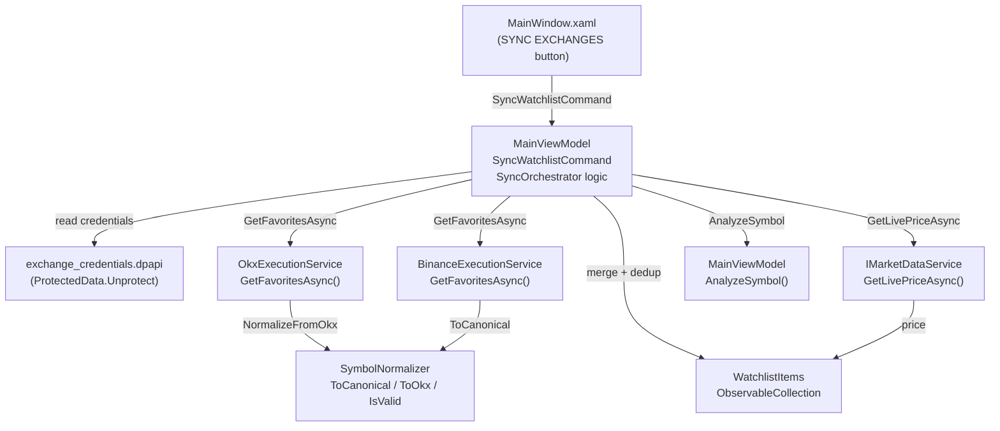

# Design Document: Watchlist Exchange Sync

## Overview

This feature adds a "Sync with Exchanges" capability to the TMQ Dashboard Watchlist. When triggered, the `SyncOrchestrator` (implemented inside `MainViewModel`) reads DPAPI-encrypted credentials, calls `GetFavoritesAsync()` on each configured exchange adapter, merges and de-duplicates the returned symbols into `WatchlistItems`, enriches each new symbol with a live price, and triggers AI analysis sequentially.

The design introduces three new artifacts in `06_Contracts`:
- `ExchangeSyncException` — typed exception carrying exchange name and detail
- `SymbolNormalizer` — static helper for canonical ↔ exchange-specific symbol conversion
- `IExchangeService.GetFavoritesAsync()` — new contract method

And extends two existing infrastructure services:
- `OkxExecutionService.GetFavoritesAsync()`
- `BinanceExecutionService.GetFavoritesAsync()`

Plus a mock implementation:
- `MockBrokerService.GetFavoritesAsync()`

---

## Architecture



### Component Table

| Component | Layer | Responsibility |
|---|---|---|
| `IExchangeService` | `06_Contracts` | Declares `GetFavoritesAsync()` contract |
| `ExchangeSyncException` | `06_Contracts/Exceptions` | Typed exception with `ExchangeName` + `Detail` |
| `SymbolNormalizer` | `06_Contracts/Helpers` | Pure static symbol conversion and validation |
| `OkxExecutionService` | `03_Infrastructure` | Fetches live SPOT instruments from OKX REST API |
| `BinanceExecutionService` | `03_Infrastructure` | Fetches non-zero balance assets from Binance REST API |
| `MockBrokerService` | `03_Infrastructure` | Returns hardcoded test symbols |
| `MainViewModel` (SyncOrchestrator) | `04_UI` | Orchestrates credential loading, exchange calls, merge, price enrichment, AI trigger |
| `MainWindow.xaml` | `04_UI` | Watchlist sidebar with SYNC EXCHANGES button and status label |
| `SymbolNormalizerTests` | `05_Tests` | FsCheck property-based tests for normalization invariants |

---

## Components and Interfaces

### ExchangeSyncException

```csharp
// 06_Contracts/Exceptions/ExchangeSyncException.cs
namespace ThatsMyQuant.Contracts.Exceptions;

public sealed class ExchangeSyncException : Exception
{
    public string ExchangeName { get; }
    public string Detail { get; }

    public ExchangeSyncException(string exchangeName, string detail)
        : base($"[{exchangeName}] {detail}")
    {
        ExchangeName = exchangeName;
        Detail = detail;
    }
}
```

### IExchangeService extension

```csharp
// 06_Contracts/Interfaces/IExchangeService.cs — add to existing interface
Task<List<string>> GetFavoritesAsync();
// Returns canonical symbols (uppercase, no hyphens, e.g. "BTCUSDT")
```

### SymbolNormalizer

```csharp
// 06_Contracts/Helpers/SymbolNormalizer.cs
namespace ThatsMyQuant.Contracts.Helpers;

public static class SymbolNormalizer
{
    // Known quote assets for OKX round-trip conversion
    private static readonly string[] QuoteAssets = ["USDT", "USDC", "BTC", "ETH", "EUR", "TRY"];

    /// <summary>
    /// Converts any exchange symbol to canonical form: removes hyphens, uppercases.
    /// e.g. "BTC-USDT" → "BTCUSDT", "btcusdt" → "BTCUSDT"
    /// </summary>
    public static string ToCanonical(string symbol)
        => symbol.Replace("-", string.Empty).ToUpperInvariant();

    /// <summary>
    /// Converts canonical symbol to OKX hyphenated format.
    /// e.g. "BTCUSDT" → "BTC-USDT"
    /// Returns the canonical symbol unchanged if no known quote asset matches.
    /// </summary>
    public static string ToOkx(string canonical)
    {
        foreach (var quote in QuoteAssets)
        {
            if (canonical.EndsWith(quote, StringComparison.Ordinal) && canonical.Length > quote.Length)
                return $"{canonical[..^quote.Length]}-{quote}";
        }
        return canonical;
    }

    /// <summary>
    /// Returns true if the symbol matches ^[A-Z][A-Z0-9]{1,19}$
    /// </summary>
    public static bool IsValid(string canonical)
        => !string.IsNullOrEmpty(canonical)
           && System.Text.RegularExpressions.Regex.IsMatch(canonical, @"^[A-Z][A-Z0-9]{1,19}$");
}
```

### OkxExecutionService.GetFavoritesAsync

```csharp
public async Task<List<string>> GetFavoritesAsync()
{
    var timestamp = GetIsoTimestamp();
    var path = "/api/v5/account/instruments?instType=SPOT";
    var signature = ComputeSignature(timestamp, "GET", path, string.Empty);

    using var request = new HttpRequestMessage(HttpMethod.Get, $"{BaseUrl}{path}");
    request.Headers.Add("OK-ACCESS-KEY", ApiKey);
    request.Headers.Add("OK-ACCESS-SIGN", signature);
    request.Headers.Add("OK-ACCESS-TIMESTAMP", timestamp);
    request.Headers.Add("OK-ACCESS-PASSPHRASE", Passphrase);
    if (IsDemoMode) request.Headers.Add("x-simulated-trading", "1");

    var response = await _httpClient.SendAsync(request);
    if (!response.IsSuccessStatusCode)
    {
        var error = await response.Content.ReadAsStringAsync();
        throw new ExchangeSyncException("OKX", $"HTTP {(int)response.StatusCode}: {error}");
    }

    var json = await response.Content.ReadAsStringAsync();
    using var doc = JsonDocument.Parse(json);
    var root = doc.RootElement;

    var code = root.GetProperty("code").GetString();
    if (code != "0")
    {
        var msg = root.GetProperty("msg").GetString() ?? "Unknown error";
        throw new ExchangeSyncException("OKX", $"code={code}: {msg}");
    }

    var results = new List<string>();
    foreach (var inst in root.GetProperty("data").EnumerateArray())
    {
        var state = inst.GetProperty("state").GetString();
        if (state != "live") continue;
        var instId = inst.GetProperty("instId").GetString();
        if (string.IsNullOrEmpty(instId)) continue;
        var canonical = SymbolNormalizer.ToCanonical(instId);
        if (SymbolNormalizer.IsValid(canonical))
            results.Add(canonical);
    }
    return results;
}
```

### BinanceExecutionService.GetFavoritesAsync

```csharp
// Stablecoins/base assets to skip when building watchlist symbols
private static readonly HashSet<string> SkippedAssets =
    new(StringComparer.OrdinalIgnoreCase) { "USDT", "BUSD", "BNB", "USDC", "FDUSD" };

public async Task<List<string>> GetFavoritesAsync()
{
    var timestamp = DateTimeOffset.UtcNow.ToUnixTimeMilliseconds().ToString();
    var queryString = $"timestamp={timestamp}";
    var signature = ComputeSignature(queryString);

    var response = await _httpClient.GetAsync($"{BaseUrl}/api/v3/account?{queryString}&signature={signature}");
    if (!response.IsSuccessStatusCode)
    {
        var error = await response.Content.ReadAsStringAsync();
        throw new ExchangeSyncException("Binance", $"HTTP {(int)response.StatusCode}: {error}");
    }

    var json = await response.Content.ReadAsStringAsync();
    using var doc = JsonDocument.Parse(json);
    var balances = doc.RootElement.GetProperty("balances");

    var results = new List<string>();
    foreach (var balance in balances.EnumerateArray())
    {
        var asset = balance.GetProperty("asset").GetString() ?? string.Empty;
        if (SkippedAssets.Contains(asset)) continue;

        var free = decimal.TryParse(balance.GetProperty("free").GetString(), out var f) ? f : 0m;
        var locked = decimal.TryParse(balance.GetProperty("locked").GetString(), out var l) ? l : 0m;
        if (free + locked <= 0m) continue;

        var canonical = SymbolNormalizer.ToCanonical(asset + "USDT");
        if (SymbolNormalizer.IsValid(canonical))
            results.Add(canonical);
    }
    return results;
}
```

### MockBrokerService.GetFavoritesAsync

```csharp
public Task<List<string>> GetFavoritesAsync()
    => Task.FromResult(new List<string> { "BTCUSDT", "ETHUSDT", "SOLUSDT", "BNBUSDT", "XRPUSDT" });
```

### MainViewModel additions

```csharp
// New observable properties
[ObservableProperty] private bool _isSyncingWatchlist = false;
[ObservableProperty] private string _syncStatusMessage = string.Empty;

// CanExecute guard
private bool CanSyncWatchlist() => !IsSyncingWatchlist;

// Command
[RelayCommand(CanExecute = nameof(CanSyncWatchlist))]
private async Task SyncWatchlist()
{
    IsSyncingWatchlist = true;
    SyncStatusMessage = "Syncing with exchanges...";

    var (okxSymbols, binanceSymbols, okxError, binanceError) = await FetchFromExchangesAsync();

    var allSymbols = okxSymbols.Concat(binanceSymbols)
        .Where(SymbolNormalizer.IsValid)
        .Distinct(StringComparer.OrdinalIgnoreCase)
        .ToList();

    var existingSymbols = WatchlistItems
        .Select(w => w.Symbol)
        .ToHashSet(StringComparer.OrdinalIgnoreCase);

    var newSymbols = allSymbols.Where(s => !existingSymbols.Contains(s)).ToList();

    foreach (var symbol in newSymbols)
    {
        var item = new WatchlistItemViewModel { Symbol = symbol };
        WatchlistItems.Add(item);

        try
        {
            var price = await _marketDataService.GetLivePriceAsync(symbol, "CRYPTO");
            if (price > 0) item.Price = price;
        }
        catch { /* leave price at 0 */ }
    }

    foreach (var symbol in newSymbols)
    {
        try { await AnalyzeSymbol(symbol, "CRYPTO", MarketOverview.SelectedTimeframe); }
        catch (Exception ex) { AddSystemLog($"SYNC: AI analysis failed for {symbol}: {ex.Message}"); }
    }

    SyncStatusMessage = BuildStatusMessage(okxError, binanceError, newSymbols.Count);
    IsSyncingWatchlist = false;
}
```

---

## Data Models

### Credential loading in SyncWatchlist

The `SyncOrchestrator` reads `exchange_credentials.dpapi` using the same pattern as `ExchangeSettingsViewModel.LoadCredentialsDpapi`. The file contains a JSON object with Base64-encoded DPAPI-protected fields:

```json
{
  "ApiKey": "<base64-dpapi>",
  "SecretKey": "<base64-dpapi>",
  "Passphrase": "<base64-dpapi>"
}
```

For Binance, `ApiKey` and `SecretKey` are read. For OKX, all three fields are read. If the file is missing or `ProtectedData.Unprotect` throws, that exchange is treated as unavailable (partial sync rules apply).

Decrypted byte arrays are cleared with `Array.Clear` immediately after constructing the `HttpClient` auth headers.

### WatchlistItemViewModel (existing, no changes)

```csharp
public partial class WatchlistItemViewModel : ObservableObject
{
    [ObservableProperty] string _symbol = "";
    [ObservableProperty] decimal _price;
    [ObservableProperty] double _changePercent;
    public string ChangeText => $"% {(ChangePercent >= 0 ? "+" : "")}{ChangePercent:F2}";
}
```

### ExchangeSyncException fields

| Property | Type | Description |
|---|---|---|
| `ExchangeName` | `string` | "OKX" or "Binance" |
| `Detail` | `string` | HTTP status + body or API error code + message |

---

## Data Flow Pseudocode

```
SyncWatchlist():
  IsSyncingWatchlist = true
  SyncStatusMessage = "Syncing with exchanges..."

  okxSymbols = []
  binanceSymbols = []
  okxError = null
  binanceError = null

  try:
    creds = LoadCredentialsDpapi()
    okxClient = new OkxExecutionService(creds.OkxKey, creds.OkxSecret, creds.OkxPassphrase)
    okxSymbols = await okxClient.GetFavoritesAsync()
  catch ExchangeSyncException ex:
    okxError = ex.ExchangeName
    logger.LogWarning(ex, "Exchange sync failed: {Exchange}", ex.ExchangeName)

  try:
    creds = LoadCredentialsDpapi()
    binanceClient = new BinanceExecutionService(creds.BinanceKey, creds.BinanceSecret)
    binanceSymbols = await binanceClient.GetFavoritesAsync()
  catch ExchangeSyncException ex:
    binanceError = ex.ExchangeName
    logger.LogWarning(ex, "Exchange sync failed: {Exchange}", ex.ExchangeName)

  allSymbols = (okxSymbols ∪ binanceSymbols)
               .Where(IsValid)
               .Distinct()

  existingSet = WatchlistItems.Select(w => w.Symbol).ToHashSet()
  newSymbols = allSymbols.Where(s => s ∉ existingSet)

  for each symbol in newSymbols:
    item = new WatchlistItemViewModel { Symbol = symbol }
    WatchlistItems.Add(item)
    try:
      price = await _marketDataService.GetLivePriceAsync(symbol, "CRYPTO")
      if price > 0: item.Price = price
    catch: // leave price at 0, continue

  for each symbol in newSymbols:
    try:
      await AnalyzeSymbol(symbol, "CRYPTO", SelectedTimeframe)
    catch ex:
      AddSystemLog($"SYNC: AI analysis failed for {symbol}: {ex.Message}")

  SyncStatusMessage = BuildStatusMessage(okxError, binanceError, newSymbols.Count)
  IsSyncingWatchlist = false

BuildStatusMessage(okxError, binanceError, n):
  if okxError != null AND binanceError != null:
    return "Sync failed: unable to reach OKX and Binance."
  if okxError != null OR binanceError != null:
    failedName = okxError ?? binanceError
    return $"Partial sync: {failedName} unavailable. {n} symbols imported."
  return $"Sync complete. {n} new symbols added."
```

---

## Watchlist UI (MainWindow.xaml)

Add to the right sidebar (`Grid.Column="1"`), below existing content:

```xml
<!-- WATCHLIST section -->
<Border Style="{StaticResource TerminalCardStyle}" Margin="0,0,0,8" Padding="12,10">
    <StackPanel>
        <TextBlock Text="WATCHLIST" Foreground="{StaticResource TextMuted}"
                   FontSize="9" FontWeight="Bold" Margin="0,0,0,8"/>
        <ItemsControl ItemsSource="{Binding WatchlistItems}">
            <ItemsControl.ItemTemplate>
                <DataTemplate>
                    <Grid Margin="0,0,0,4">
                        <Grid.ColumnDefinitions>
                            <ColumnDefinition Width="*"/>
                            <ColumnDefinition Width="Auto"/>
                            <ColumnDefinition Width="Auto"/>
                        </Grid.ColumnDefinitions>
                        <TextBlock Grid.Column="0" Text="{Binding Symbol}"
                                   FontFamily="{StaticResource MonoFont}" FontSize="10" FontWeight="Bold"/>
                        <TextBlock Grid.Column="1" Text="{Binding Price, StringFormat={}{0:F2}}"
                                   FontFamily="{StaticResource MonoFont}" FontSize="10" Margin="8,0"/>
                        <TextBlock Grid.Column="2" Text="{Binding ChangeText}"
                                   Foreground="{Binding Color}" FontSize="9"/>
                    </Grid>
                </DataTemplate>
            </ItemsControl.ItemTemplate>
        </ItemsControl>
        <Button Content="SYNC EXCHANGES"
                Command="{Binding SyncWatchlistCommand}"
                IsEnabled="{Binding IsSyncingWatchlist, Converter={StaticResource InverseBooleanConverter}}"
                Style="{StaticResource DeckActionButtonAccentStyle}"
                Margin="0,8,0,4"/>
        <TextBlock Text="{Binding SyncStatusMessage}"
                   Foreground="{StaticResource TextSoft}"
                   FontSize="9" TextWrapping="Wrap"/>
    </StackPanel>
</Border>
```

---

## Correctness Properties

*A property is a characteristic or behavior that should hold true across all valid executions of a system — essentially, a formal statement about what the system should do. Properties serve as the bridge between human-readable specifications and machine-verifiable correctness guarantees.*

### Property 1: OKX symbol round-trip

*For any* valid OKX-format symbol (e.g., `BTC-USDT`), converting to `CanonicalSymbol` via `ToCanonical` and then back to OKX format via `ToOkx` SHALL produce a symbol equivalent to the original.

**Validates: Requirements 2.4, 9.1**

### Property 2: Normalization idempotence

*For any* string, applying `ToCanonical` twice SHALL produce the same result as applying it once: `ToCanonical(ToCanonical(x)) == ToCanonical(x)`.

**Validates: Requirements 2.3, 9.2**

### Property 3: Union-with-dedup (including cross-exchange)

*For any* existing `WatchlistItems` list and any combination of OKX and Binance symbol lists, the merged `WatchlistItems` after sync SHALL contain every unique `CanonicalSymbol` from all inputs exactly once — no symbol appears more than once regardless of whether it came from OKX, Binance, or was already in the watchlist.

**Validates: Requirements 4.2, 4.3, 4.5, 9.3, 9.5**

### Property 4: No-removal invariant

*For any* existing `WatchlistItems` list and any exchange-returned symbol lists, the count of `WatchlistItems` after sync SHALL be greater than or equal to the count before sync, and every symbol present before sync SHALL still be present after sync.

**Validates: Requirements 4.1, 4.4, 9.4**

### Property 5: CanonicalSymbol format invariant

*For any* string that passes `IsValid`, the string SHALL match the pattern `^[A-Z][A-Z0-9]{1,19}$`. Conversely, any string that does not match this pattern SHALL cause `IsValid` to return `false`.

**Validates: Requirements 2.5, 9.6**

### Property 6: OKX SPOT+live filter

*For any* list of OKX instrument objects with varying `instType` and `state` values, `GetFavoritesAsync` SHALL return only instruments where `instType == "SPOT"` and `state == "live"`.

**Validates: Requirements 1.4, 1.8**

### Property 7: Binance non-zero balance filter

*For any* list of Binance balance objects, `GetFavoritesAsync` SHALL return only assets where `free + locked > 0` and the asset is not in the skip list (`USDT`, `BUSD`, `BNB`, etc.), with each result being the asset name concatenated with `USDT`.

**Validates: Requirements 1.5**

### Property 8: Price enrichment assignment

*For any* positive decimal price returned by `IMarketDataService.GetLivePriceAsync`, the corresponding `WatchlistItemViewModel.Price` SHALL be set to exactly that value.

**Validates: Requirements 5.2**

### Property 9: Only new symbols trigger AI analysis

*For any* pre-existing `WatchlistItems` list, `AnalyzeSymbol` SHALL NOT be called for any symbol that was already present before the sync began — only symbols newly added during the current sync receive AI analysis.

**Validates: Requirements 6.2**

### Property 10: Status message reflects correct count

*For any* number `N` of newly added symbols, the `SyncStatusMessage` after a successful sync SHALL contain the string representation of `N`. For partial sync, the message SHALL contain both the failing exchange name and `N`. For total failure, the message SHALL be the fixed failure string.

**Validates: Requirements 7.3, 7.4, 7.5**

---

## Error Handling

| Scenario | Behavior |
|---|---|
| `exchange_credentials.dpapi` missing | Treat that exchange as unavailable; apply partial sync rules |
| `ProtectedData.Unprotect` throws | Same as above |
| OKX HTTP error (non-2xx) | Throw `ExchangeSyncException("OKX", detail)` |
| OKX response `code != "0"` | Throw `ExchangeSyncException("OKX", detail)` |
| Binance HTTP error (non-2xx) | Throw `ExchangeSyncException("Binance", detail)` |
| Both exchanges fail | `SyncStatusMessage = "Sync failed: unable to reach OKX and Binance."` |
| One exchange fails | `SyncStatusMessage = "Partial sync: {name} unavailable. {N} symbols imported."` |
| `GetLivePriceAsync` throws or returns 0 | Leave `Price = 0`, continue to next symbol |
| `AnalyzeSymbol` throws | Log at error level, continue to next symbol |
| Symbol fails `IsValid` after normalization | Discard silently |

All `ExchangeSyncException` instances are logged at `Warning` level including `ExchangeName` and `Message`.

---

## Testing Strategy

### Unit Tests

Focus on specific examples and error conditions:

- `ExchangeSyncException` carries correct `ExchangeName` and `Detail`
- `IsSyncingWatchlist` is `false` by default
- `SyncWatchlistCommand.CanExecute()` returns `false` when `IsSyncingWatchlist` is `true`
- `SyncStatusMessage` is set to `"Syncing with exchanges..."` at start of command
- `IsSyncingWatchlist` is reset to `false` after sync completes (success and failure paths)
- Both-fail path produces the correct fixed status message
- One-fail path produces the partial sync message with correct exchange name
- Missing credentials file causes that exchange to be skipped
- `GetLivePriceAsync` returning 0 leaves `Price` at 0 and does not abort remaining symbols
- `AnalyzeSymbol` throwing for one symbol does not abort remaining symbols
- OKX HTTP error throws `ExchangeSyncException` with `ExchangeName == "OKX"`
- Binance HTTP error throws `ExchangeSyncException` with `ExchangeName == "Binance"`

### Property-Based Tests

Use **FsCheck.Xunit 3.x** with minimum **100 iterations** per property.

File: `05_Tests/ThatsMyQuant.Tests/Watchlist/SymbolNormalizerTests.cs`

Each test is tagged with a comment referencing the design property:
```
// Feature: watchlist-exchange-sync, Property N: <property_text>
```

Properties to implement:

| Test | Design Property | Generator |
|---|---|---|
| `ToCanonical_then_ToOkx_roundtrip` | Property 1 | Valid OKX symbols: `{BASE}-{QUOTE}` where QUOTE ∈ known quote assets |
| `ToCanonical_idempotent` | Property 2 | Arbitrary non-null strings |
| `Merge_union_with_dedup` | Property 3 | Arbitrary lists of canonical symbols for existing watchlist + exchange results |
| `Merge_no_removal` | Property 4 | Arbitrary existing watchlist + arbitrary exchange results |
| `IsValid_format_invariant` | Property 5 | Strings matching and not matching `^[A-Z][A-Z0-9]{1,19}$` |
| `GetFavoritesAsync_okx_spot_live_filter` | Property 6 | Random instrument lists with mixed instType/state |
| `GetFavoritesAsync_binance_nonzero_filter` | Property 7 | Random balance lists with varying free/locked values |
| `PriceEnrichment_sets_price` | Property 8 | Arbitrary positive decimal prices |
| `SyncStatusMessage_contains_count` | Property 10 | Arbitrary counts N ≥ 0 |

Property 9 (only new symbols trigger AI) is tested as a unit test using a mock that records `AnalyzeSymbol` call arguments, verifying no pre-existing symbol appears in the call list.
